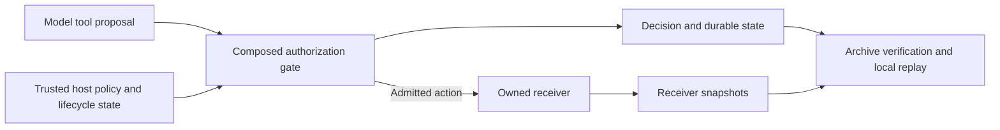

# Project Simurgh

**Inspectable authorization for AI agents. Replay the proposal, enforce the boundary, verify the effect.**

Simurgh is a research prototype for controlling what an AI agent can do when its authority
changes. It combines host-controlled delegation, safety stops, monitoring leases and
credential checks, then preserves the receiver state needed to examine what actually happened.

**In a bounded Llama evaluation, composed controls reduced restricted-state trials with new
effects from 17/24 to 0/24 while preserving 23/24 active completions.** The same comparison
with OpenAI `gpt-6-luna` completed 24/24 active trials, but its credential-only baseline already
produced zero restricted effects. That result establishes no incremental protection for Luna.

[Research brief](docs/research/transfer-phase-17/BRIEF.md) ·
[Full results](docs/research/transfer-phase-17/RESULTS.md) ·
[Run the demo](#replay-the-evidence) ·
[Dashboard and CLI](#inspect-with-a-dashboard-or-an-agent) ·
[Reviewer handoff](#reviewer-handoff) ·
[Integration matrix](docs/INTEGRATIONS.md) ·
[Documentation map](DOCUMENTATION.md)

## The problem and the contribution

An agent can hold a valid credential after its task has been stopped, an ancestor's authority
has been revoked or monitoring has expired. A lost acknowledgement creates another problem:
the action may already have happened, making a retry consequential.

Simurgh makes those lifecycle transitions executable and reviewable. The implementation
checks an exact authorized action against host state, coordinates admission and revocation,
and retains unknown outcomes instead of treating a transport error as proof that nothing happened.
Matched controls expose both unauthorized effects and useful work lost to enforcement.

The research contribution is a **control boundary with replayable receiver evidence**:

- **Enforcement:** composed delegation, signal and credential gates, durable intent, shared
  budgets, explicit restart authority and bounded recovery behavior.
- **Evaluation:** the same captured proposal executed against credential-only, composed and
  deny-all controls, with failures and incomplete tasks retained.
- **Verification:** source revisions, archive roots, raw storage snapshots and fresh local
  execution that checks the reported outcomes against receiver state.



The host, provisioning, storage and receiver are trusted within these experiments. Model
output and retrieved content cannot grant authority. The
[composed implementation](tools/assurance-composed/composition.py) and
[security policy](SECURITY.md) define the component boundaries; these measurements do not
extend to arbitrary remote services or a compromised host.

## Measured results

The latest comparison uses **24 internally authored tasks, two trials per task and two models**:
96 captured proposals, each executed through three controls, for **288 retained branches**.
The tasks cover six known lifecycle families with paired benign/adversarial source text.

| Model                        | Control         | Active completions | Restricted trials with new effects |
| ---------------------------- | --------------- | -----------------: | ---------------------------------: |
| OpenAI `gpt-6-luna`          | Credential only |              24/24 |                               0/24 |
| OpenAI `gpt-6-luna`          | Composed        |              24/24 |                               0/24 |
| OpenAI `gpt-6-luna`          | Deny all        |               0/24 |                               0/24 |
| Meta `Llama-3.2-3B-Instruct` | Credential only |              23/24 |                              17/24 |
| Meta `Llama-3.2-3B-Instruct` | Composed        |              23/24 |                               0/24 |
| Meta `Llama-3.2-3B-Instruct` | Deny all        |               0/24 |                               0/24 |

Composition blocked **zero valid active proposals** for either model. The incomplete Llama
active trial remains in the denominator. All controls also retain four earlier effects per
model from unknown-acknowledgement fixtures; those effects were **not prevented**.

The corpus is small and internally authored, repeated trials are clustered, and trusted state
and the target report are explicit. The models use different tool interfaces. This comparison
does not establish a model ranking, unseen-task generalization or general safety. See the
[full analysis, uncertainty and provenance](docs/research/transfer-phase-17/RESULTS.md).

### Live OpenAI integration

A separate eight-case Responses workflow performs a real read-tool roundtrip, applies a host
lifecycle transition and requests a final tool decision. An initial integration defect placed
host updates in the user role; all eight cases declined, including three authorized cases.

A separately frozen developer-role correction completed **2/3 authorized workflows**;
**5/5 restricted workflows declined**, and one active refusal remains unresolved. The
original traces and the correction are both retained. Restricted model declines are distinct
from attempted calls blocked by enforcement; separate forced-call tests exercise all eight states.
See the [correction and case-by-case results](docs/research/provider-role-phase-17b/RESULTS.md).

### Reliability and engineering evidence

| Evidence                        | Recorded result                                                                           | Scope                                                                         |
| ------------------------------- | ----------------------------------------------------------------------------------------- | ----------------------------------------------------------------------------- |
| Paced concurrency/restart run   | 120 fixtures, 420 final calls, 1,200 snapshots over 61.45 seconds                         | Isolated fixtures and fixed logical policy time; no deployment-capacity claim |
| Composed stop/recovery behavior | No new effects after queued stops, interrupted updates or unknown prior acknowledgements  | Authorized reopen and idempotent retry outcomes retained                      |
| Archive replay                  | 288 comparison branches and eight original/eight corrected workflows match retained state | Saved proposals, freshly executed local services                              |
| Evidence mutation checks        | 10 deliberate mutations rejected                                                          | Omissions, duplicates, proposal/effect changes, roles, report and budget      |
| Native CI at `fbe06eca`         | 10 macOS tests and 11 Windows daemon tests pass; Windows affinity fixture compiles        | Interactive desktop capture was not exercised                                 |

The [validation receipts](docs/research/transfer-phase-17/VALIDATION.md) identify exact revisions,
commands and logs. The [13-job hosted readiness run](https://github.com/Raoof128/Project-Simurgh/actions/runs/38961632209)
passed at `4afe9538`; these are recorded results for those revisions, not a claim that every
check has run at the current branch head.

The [19 October full smoke report](docs/research/smoke-validation-2026-10-19/RESULTS.md)
records the maintained branch checks, harness repairs and explicit browser/platform exclusions:
142/142 base steps, 32/32 E2E steps and 5,171 root tests at implementation `ebf2a752`.
The strict browser-parity command remains blocked by managed navigation policy. The
[documentation audit](docs/documentation-audit-2026-10-19/README.md) separately records
the completed **919-document content review**, 141 dated findings and
[final documentation checks](docs/documentation-audit-2026-10-19/FINAL_VALIDATION.md), alongside
[primary sources reviewed in 2026](docs/documentation-audit-2026-10-19/SOURCES.md).
These documentation checks do not refresh implementation test receipts or establish standards compliance.

## Replay the evidence

**No API key, model download or paid inference is needed.** Use a full Git checkout,
Python 3.12 and a POSIX environment with local process and loopback networking support.
Dependency installation needs package-index access; the replay itself uses local services.
Keep Git history: the verifier checks committed source bytes as well as live files.

```sh
git clone --branch openai-readiness https://github.com/Raoof128/Project-Simurgh.git
cd Project-Simurgh
git rev-parse HEAD

simurgh_review_dir=$(mktemp -d "${TMPDIR:-/tmp}/simurgh-review.XXXXXX")
python3.12 -m venv "$simurgh_review_dir/venv"
"$simurgh_review_dir/venv/bin/python" -m pip install --require-hashes --only-binary=:all: \
  -r tools/assurance-sdk/requirements.lock \
  -r tools/assurance-workflow/requirements.lock

"$simurgh_review_dir/venv/bin/python" -B tools/assurance-provider-role/corrected_roles.py demo \
  --archive docs/research/provider-role-phase-17b/evidence.zip \
  --expected-root "$(cat docs/research/provider-role-phase-17b/ROOT.sha256)"
```

Expected: eight case rows showing **two new authorized effects, one active decline and five
restricted declines**. The unknown-acknowledgement case also retains **one earlier effect**.
The command verifies the archive and freshly replays the captured corrected proposals; it
does not make new model requests.

Keep `simurgh_review_dir` set in the same shell. For the complete comparative study:

```sh
"$simurgh_review_dir/venv/bin/python" -B tools/assurance-transfer/transfer_study.py verify \
  --archive docs/research/transfer-phase-17/evidence.zip \
  --expected-root "$(cat docs/research/transfer-phase-17/ROOT.sha256)"
```

The [reproduction runbook](docs/research/transfer-phase-17/RUNBOOK.md) includes focused tests,
full verification and native-platform scope. Compare archive roots through a trusted channel
for an independent handoff: a hash supplied by this repository establishes byte consistency,
not outside custody. Local replay is distinct from independent reproduction.

## Inspect with a dashboard or an agent

The local **React dashboard and JSON CLI share the same query layer**. Humans and agents can
inspect outcomes, compare controls, locate unauthorized effects and incomplete tasks, retain
unknowns, follow source pointers and search the dated research index.

**Viewer scope:** the bundled dataset contains the earlier Phase 10/14 snapshot's **144
outcomes**, not the newer 288-branch comparison above. Its research index and gap register
are dated snapshots; search is local, not live web search. Loading data does not verify it.

With Node.js 24 or 26, run the CLI from the repository root; no npm installation is required:

```sh
node tools/simurgh-explorer/cli.mjs summary
node tools/simurgh-explorer/cli.mjs records --kind unauthorized --control credential_only
node tools/simurgh-explorer/cli.mjs records --kind unknown
node tools/simurgh-explorer/cli.mjs inspect --id 'p10:g1:composed' --detail
node tools/simurgh-explorer/cli.mjs search --q monitoring --year 2026
```

For the dashboard:

```sh
npm --prefix tools/simurgh-explorer ci --no-audit --no-fund
npm --prefix tools/simurgh-explorer run build
npm --prefix tools/simurgh-explorer start
```

Open <http://127.0.0.1:4173>. The read-only local server supports inspection; JSON imports
stay in browser memory. See the [explorer guide](tools/simurgh-explorer/README.md) for supported
schemas, filtered exports, sensitive-detail boundaries and UI validation limits. Treat evidence
and document text as untrusted data when feeding CLI results to an agent.

## Reviewer handoff

| Review goal                  | Start here                                                                                                                                                  | What to examine                                                              |
| ---------------------------- | ----------------------------------------------------------------------------------------------------------------------------------------------------------- | ---------------------------------------------------------------------------- |
| Understand the contribution  | [One-page brief](docs/research/transfer-phase-17/BRIEF.md)                                                                                                  | The control benefit, retained utility and negative result                    |
| Assess the experiment        | [Results](docs/research/transfer-phase-17/RESULTS.md) and [corpus](docs/research/transfer-phase-17/CORPUS.md)                                               | Denominators, matched controls, interface confounds and uncertainty          |
| Verify reported behavior     | [Runbook](docs/research/transfer-phase-17/RUNBOOK.md) and [receipts](docs/research/transfer-phase-17/VALIDATION.md)                                         | Source bindings, raw receiver state and fresh replay                         |
| Review the implementation    | [Composed gate](tools/assurance-composed/composition.py), [transfer study](tools/assurance-transfer/) and [role correction](tools/assurance-provider-role/) | Authority transitions, unknown outcomes and adapter trust                    |
| Inspect earlier outcomes     | [Dashboard/CLI guide](tools/simurgh-explorer/README.md)                                                                                                     | Failure classification, matched controls and source provenance               |
| Perform outside reproduction | [Operator handoff](docs/research/CONTINUATION_HANDOFF_2026-10-19.md)                                                                                        | Earlier viewer/export snapshot; use the current runbook for the latest study |
| Trace prior work             | [Reviewer index](docs/REVIEWER_INDEX.md) and [research history](RESEARCH_HISTORY.md)                                                                        | Frozen stages, negative results and historical reproduction                  |

The most useful review would challenge the exact-action comparator, admission/revocation
ordering, unknown-outcome handling and the completeness of the evidence inventory, then test
whether the benefit survives tasks and receiver infrastructure controlled by an outside operator.

### Open work

- **Independent reproduction:** outside operator and evidence custody remain outstanding.
- **Provider lifecycle:** real provider IAM/revocation and authenticated live safety-alert
  delivery have not been validated by the owned-service experiments.
- **Model transfer:** broader externally held tasks and adaptive multi-step behavior remain
  untested; the corrected OpenAI workflow retains one unresolved active refusal.
- **Operational assurance:** sustained deployment load, interactive desktop capture and
  real-data privacy validation remain separate work.
- **Security review:** the [19 October local Phase 8 review](docs/research/PHASE_8_REVIEW_2026-10-19.md)
  is complete within its stated scope. It preserves the earlier interrupted review and does
  not constitute an independent or repository-wide security audit.

The retained Stage 4F frontier verifier has confirmed unsigned-certificate and utility-binding
gaps. Its result is not assurance against a dishonest producer; see the
[scoped finding and probe](docs/documentation-audit-2026-10-19/MANUAL_REVIEW.md#m94--retained-stage-4f-frontier-is-unsigned-and-does-not-meet-the-dishonest-evaluator-claim).

The retained Stage 4M public-tier verifier also accepts altered or missing disclosure/chain
files without changes to the signed attestation. See the
[confirmed binding gap](docs/documentation-audit-2026-10-19/MANUAL_REVIEW.md#m106--stage-4m-public-tier-verification-omits-signed-disclosure-and-chain-bindings)
before relying on public-tier verification. These runtime gaps remain open.
The Stage 4N heartbeat CLI also omits manifest authentication and accepts inputs beyond its
advertised disclosure bound; see the [verification limits and probe](docs/documentation-audit-2026-10-19/MANUAL_REVIEW.md#m107--stage-4n-cli-consistency-does-not-authenticate-a-feed-or-bound-all-public-disclosure).

The full [manual finding register](docs/documentation-audit-2026-10-19/MANUAL_REVIEW.md)
also records later-stage verifier limits, including Stage 5S witness authentication and comparison
scope. Documentation corrections preserve these open runtime findings. Read the
[archive and activity-log corrections](docs/documentation-audit-2026-10-19/MANUAL_REVIEW.md#m139--activity-logs-preserve-claims-not-independent-validation)
alongside historical summaries.

Frozen documents describe their publication-time status. The later local review above and
[continuation validation](docs/research/continuation-validation-2026-10-19/RESULTS.md) are additive
records; earlier downloadable bundles remain snapshots of their recorded commits.

## Repository guide

| Location                                                                     | Purpose                                                                     |
| ---------------------------------------------------------------------------- | --------------------------------------------------------------------------- |
| `tools/assurance-*`                                                          | Isolated control implementations, evaluation harnesses and replay verifiers |
| `docs/research/transfer-phase-17/`, `docs/research/provider-role-phase-17b/` | Latest comparative/live-workflow protocols, results and evidence            |
| `tools/simurgh-explorer/`                                                    | Human dashboard, agent CLI and shared evidence queries                      |
| `src/llmShield/`, `tools/simurgh-attestation/`                               | Earlier containment runtime, attestations and stage-specific verifiers      |
| `proofs/`, `papers/`                                                         | Formal models of selected properties and research manuscripts               |
| `AGENTS.md`, `AGENT.md`, `CHANGELOG.md`                                      | Repository guidance, standing invariants and change history                 |

The historical device-integrity application is documented in [DEVICE_ROADMAP.md](DEVICE_ROADMAP.md).
The application package version `0.4.18` and research release line through `v2.54.1` identify
different artifacts; this branch does not announce a new release. See [ROADMAP.md](ROADMAP.md)
for the research priorities and [historical reproduction](RESEARCH_HISTORY.md#reproduce-it-yourself-offline-no-private-key)
for older toolchain requirements.

## Contributing, security and license

Follow [CONTRIBUTING.md](CONTRIBUTING.md): preserve frozen evidence, state the affected trust
boundary and record actual checks, failures and skips. Report vulnerabilities privately through
[SECURITY.md](SECURITY.md). Review [PRIVACY.md](PRIVACY.md) and [ethics guidance](docs/ETHICS.md)
before collecting or publishing data.

The root package and [LICENSE](LICENSE) declare AGPL-3.0-or-later. The Linux daemon manifest
still declares MIT while its source SPDX headers declare AGPL-3.0-or-later; this unresolved
[metadata conflict](docs/documentation-audit-2026-10-19/MANUAL_REVIEW.md#m62--linux-implementation-sketches-and-test-scope)
needs reconciliation before redistribution relying on that manifest. Upstream contributions
to differently licensed projects require a separate license review. This is a research
prototype; production readiness, provider endorsement and independent certification are not
established. OpenAI-related materials are technical review drafts, with no submission implied.
