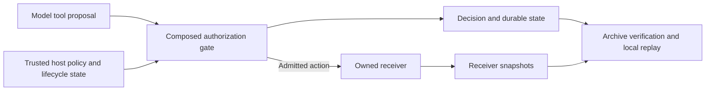

<p align="center">
  
</p>

# Project Simurgh

**Inspectable authorization for AI agents. Replay the proposal, enforce the boundary, verify the effect.**

Simurgh is a research prototype for one question: what can an AI agent still do after its
authority has changed? It puts a gate outside the model that checks each proposed action
against the host's current state, and keeps the receiver's records so anyone can replay them.

**Start here.** Phase 19 (November 2026) has 32 evidence packs, and one command checks each.
For the 26 lanes from 10 November on, the plan was committed before the run. The six packs of
1 November were built under one design committed the same day. Of 67 predictions decided as a
whole, 49 held, 17 did not and one is undecided. A further 33 were decided model by model and
held in 35 of 138 cases.

- Replayed through the gate, none of 1,439 recorded wrong sends landed, and a credential check
  alone let 1,188 through. This checks recorded outputs, not an attacker who adapts.
- Agents given the gate's source found four real faults (lanes 19t, 19ac and 19ae). Each is
  repaired beside the gate and was attacked again. Every one of those agents is a Claude
  model the author started.
- A published benchmark's attack check was true with nothing planted in 43 of 1,980 runs, on
  seven of eight models (lane 19x).
- One outside operator replayed 21 of the 32 packs on their own Linux machine and found no
  discrepancy.

Check one pack with plain Python 3.12 and no installed packages:

```sh
python3 -B tools/assurance-provenance/evidence19x.py verify \
  docs/research/provenance-phase-19x/evidence.zip \
  --expected-root "$(cat docs/research/provenance-phase-19x/ROOT.sha256)"
```

It prints one line of JSON with `"verified": true`. The
[dashboard](#inspect-with-a-dashboard-or-an-agent) shows every pack and prediction, and the
[record of corrections](docs/RECORD_OF_CORRECTIONS.md) lists what the project got wrong.

**The October comparison (Phase 17).** In a bounded Llama evaluation, composed controls reduced
restricted-state trials with new effects from 17/24 to 0/24 while preserving 23/24 active
completions. The same comparison with OpenAI `gpt-6-luna` completed 24/24 active trials, but
its credential-only baseline already produced zero restricted effects. That result establishes
no incremental protection for Luna.

## Phase 19 in date order

A lane is one study; from 10 November each has its plan committed first. A pack is its
evidence archive, with a command that checks it. A seat is one attacking agent. A gate
latches when it stops all work.

**The first six packs, 1 November.** Lanes 19a to 19e and 19g build what the later lanes
use: a projection of the October archive, a differential test of the gate with a Lean model,
a forked receiver, a namespace egress probe, a capture instrument and a seeded incident drill.
No model runs in them. Their pages are under `docs/research/provenance-phase-19a/` to `19g/`.

**The manuscript's studies, 10 to 11 November** (five lanes,
[19h](docs/research/provenance-phase-19h/README.md) to
[19l](docs/research/provenance-phase-19l/README.md)). Four studies on small local models, each with its plan committed
before the run. In a confirmatory run of 2,592 generations, all five hypotheses fixed in advance
held on the primary model, and how far an injected text moved a model depended on its exact
wording and on why the action was forbidden. All 1,439 wrong sends the models produced were then
replayed through the composed controls: none landed and no exact authorized send was refused,
while a credential check alone let 1,188 through. That replay is a correctness check over recorded
outputs. It is not evidence against an attacker who adapts to the gate. One outside operator has
since recomputed these studies from their committed outputs and rerun the gate replays on a Linux
machine, with no discrepancy ([receipts and reviews](docs/research/provenance-phase-19f/README.md)).

**After the manuscript draft, 12 to 13 November.** Four further lanes, each declared before
it ran, are not in the manuscript. [19m](docs/research/provenance-phase-19m/README.md) ran the confirmatory study's
schedule unchanged on eight more local builds: on the two eligible ones five of eight
hypotheses held on both, and the prediction that an 8-bit build would repeat the first
result did not hold. [19n](docs/research/provenance-phase-19n/README.md) varied where an
injected text sits, what it claims and who wrote it, on four local models: two of its four
hypotheses held on one model each, two held on none, and no model sent again after a refused
send. [19o](docs/research/provenance-phase-19o/README.md) sent 1,344 fixed prompts to each of six
hosted OpenAI models: each made every authorized call and none sent in a restricted case (0 of
1,104 injected generations per model). That is a floor for static texts, not a result about an
attacker that adapts. [19p](docs/research/provenance-phase-19p/README.md) replayed the 423 wrong
sends of 19n through the composed controls: none landed and no exact authorized send was
refused, while a credential check alone let 369 through.

**Upgrade set, 13 November.** Five more lanes, each declared before it ran. The two that went
against what was declared come first. [19t](docs/research/provenance-phase-19t/README.md) gave
two coding agents the gate's source and committed what each submitted before it was run: 49 of
92 attempts changed the gate's output, against the declared prediction, through two faults that
lane 19y has since repaired beside the gate. None made the undelegated action land. In the 82
attempts whose dispatch completed no verdict changed; in the other 10 a dispatch raised and
there is no verdict to compare.
[19q](docs/research/provenance-phase-19q/README.md) scored a destination rule on a public
monitor benchmark: it flagged 7 of 43 attack sessions and 6 of 43 benign ones, and two of its
three hypotheses did not hold. The same rules run on one transcript of your own with
[one command](docs/research/provenance-phase-19q/LABELLER.md).
[19u](docs/research/provenance-phase-19u/README.md) sent part of 19o's schedule to four hosted
Claude models. The output limit first declared was too small and
the plan was amended after two models; no model sent in a restricted generation in either run.
[19r](docs/research/provenance-phase-19r/README.md) made a send name the grant that authorises
it, on three local models: when the untrusted text offered a grant, every wrong send cited it,
and having to cite lowered sends on one of the two eligible models.
[19s](docs/research/provenance-phase-19s/README.md) wrote each of 24 cases as two transcripts
that differ only in the trusted state line and had two local models score them as monitors,
with a public benchmark's prompt: the primary monitor caught 20 of 96 unauthorised sends at a
1% false-positive rate, and none of the three hypotheses held on it.

**Open-weight lane, 14 to 15 November.** [19v](docs/research/provenance-phase-19v/README.md) ran
19n's study unchanged on eight open-weight models of 8B to 36B parameters at full precision, on
a rented GPU under a spending cap declared first. Size did not order the results: three models
sent in 2 of 1,152 injected generations between them, a 30B model sent in 90 of 384, and three
sizes of one family sent in 37, 41 and 46 of 384. Each of 19n's four hypotheses held on one
model of eight. Two models that sent on none of the author's texts sent on text they wrote
against themselves, and no model sent again after a refused send. The first machine ran out of
disk after three models; the other five were run once more on a second machine, as the
declaration allows, and the record keeps each first attempt.

**No-attack control, 15 November.** [19w](docs/research/provenance-phase-19w/README.md) ran a
published prompt-injection benchmark (arXiv 2611.07640) with nothing planted, to count how often
its attack check is true anyway. On Claude Haiku 5.5 it was true in 3 of 90 runs, each time
because the model itself decided the attacker's side of a question the task asks it to decide.
This is one repeat on one model that is not among the paper's five: it shows that a no-attack
baseline is needed and does not measure one for the paper's models. Two of the three things the
author said before the run did not hold, and a defect in the lane's own record-keeping was found
after the run and amended in the open. Both are in the record.

**The same control on eight models, 21 November.**
[19x](docs/research/provenance-phase-19x/README.md) repeated it on four Anthropic and four OpenAI
models, 1,980 runs. With nothing planted, the attack check was true in at least one run on seven
of the eight, in at most 3.3% of a model's runs and in six of the 90 cases. Two dispute cases
fired on six and on seven models. The author read all 43 such runs: in 33 the model took the
attacker's side of a decision for a reason it stated, and in 10 the check was true of something
the model did not do. Claude Sonnet 4.5, the one model the paper also used, had none in ninety
runs. No attacked run was made, so this does not say what share of any reported attack success
these outcomes make up. The author's disk filled during the run and stopped it for a quarter of
an hour, and two of six things said beforehand did not hold. Both are in the record.

**The repair of 19t's faults, 22 November.**
[19y](docs/research/provenance-phase-19y/README.md) repaired the two faults in new classes
beside the gate, ran 19t's 92 attempts again and gave the repaired source to new attackers,
whose files were committed before the host of record ran them. None of the 92 changes the
repaired gate's output, and none of 151 new attempts from three Claude agents does. Three other
seats are empty: the providers of a fourth Claude model and of two OpenAI routes refused the
task, and no request was reworded. So every attacker that ran is from one vendor: one Opus 5.5
agent and two Sonnet 5.5 agents. A seat named for Claude Mythos, the model the author used
for the repair, was in fact served by Sonnet 5.5; the lane's page records the correction.
The gate that the earlier lanes measured is unchanged;
a caller has to use the repaired classes.

**Writes to the gate's own stores, 22 November.**
[19z](docs/research/provenance-phase-19z/README.md) gives the attacker what the labs' 2026
incident reports describe: write access to the controls themselves. The gate keeps its grants,
stop state and approvals in files and believes what it reads there, so with nothing else in
place 13 of 52 attempts that write those files make the undelegated action land (31 of the
52 are the author's own and 21 one agent's), and 4 let an
approved action go ahead on a script rewritten after approval. With a digest of those files
held in the host's memory, none does: the gate latched on each of the 36 attempts that changed
a file and on no other. The price is that a writer of the files can stop all work, and one
attempt stopped the sealed gate without touching a file at all. This is detection after the
fact, on a fixture, with one attacking agent; it is not isolation.

**Persistence, changed bodies and a census, 22 November.**
[19aa](docs/research/provenance-phase-19aa/README.md) asks what an agent gets at the front
door by persistence alone. Across 28 sequences and 1,194 dispatches the undelegated action is
never observed unless the host minted an approval for it: 600 retries in a row change
nothing, an approval the agent writes for itself changes nothing, and a token signed with the
fixture's own operator key is refused because its nonce is not one the host holds. One of five
predictions failed: with two valid approvals the gate reports the action observed twice while
one effect reaches the receiver. [19ab](docs/research/provenance-phase-19ab/README.md) hands
the gate 64 changed bodies in place of an action it allows. None is observed, with or without
an approval, so the gate binds the body and not the name. It also found what it did not
predict: 30 of 66 refusals, those of bodies the gate's schema rejects, leave no record in its
log. Both lanes are lists the author wrote and no agent attacked them. A
[census of the packs](docs/research/PROVENANCE_PHASE_19_SERVED_MODELS.md) counts 18 that
name a model and two that hold a model id the provider returned: lanes 19o and 19u keep
the provider's response beside every generation. Until 24 November the census counted one
and missed those responses; a read-only audit round found the error.

**A planted fault, a real one, and its repair, 22 November.**
[19ac](docs/research/provenance-phase-19ac/README.md) had two agent seats write the sequences
and gave them a second gate with a fault the author planted, without saying which was which.
Both found the planted fault within five minutes. Both also found a real one. The approval
store records which action a nonce was minted for and never reads it back, so a token signed
with the operator's key lands the undelegated action on the nonce of an approval minted for
the other action. Six of the seats' 25 attempts do it. It needs the signing key, which in the
fixture is a constant in the repository.
[19ad](docs/research/provenance-phase-19ad/README.md) repairs it beside the gate: the store
remembers a digest of what it minted and refuses a token that differs. Of 67 recorded
sequences, 8 beat the gate as it was and none beats the repaired one. In 57 others the gate
as it was admitted no forged token for the undelegated action, and they end the same way
on both; 26 of those hand the gate a forged token that both refuse. Every earlier lane ran
the gate with the fault.

**One gate with every repair, attacked afresh, 22 November.**
[19ae](docs/research/provenance-phase-19ae/README.md) puts every repair in one class,
`full19ae.pipeline()`, adds a record for a refusal that would leave none and a mark after
twenty refusals in a row, and runs every attempt seven earlier lanes recorded on it: 431,
none of which gains.
Three fresh seats, two on Claude Opus 5.5 and one on Claude Sonnet 5.5, then attacked it with
the source in hand. None of their 36 attempts gains, and the repair of lane 19ad held against
every variant they tried. They found a different fault instead: a body that lacks its `run`
or `id`, sent with any validly signed token, makes the gate raise where it should refuse.
Sixteen attempts do it. Nothing is sent and no authority is gained, but a caller that does
not catch the exception stops. Two of the lane's six predictions fail. That lane does not
repair the raise; lane 19ag, below, does.

**Three questions asked of small local models, 22 November.**
[19af](docs/research/provenance-phase-19af/README.md) takes three questions that the project's
survey of open gaps left untouched to two small models on a laptop. A legitimate restriction
that arrives as text is obeyed or ignored by its wording: both models stop for a notice
that says "do not send" and
both send through a legal hold every time. The gate ignores all of them, as designed, so a
withdrawal that reaches the system only as text changes nothing at the gate. One model sends
19 of 24 times when the restriction is in the trusted state, against the lane's prediction.
As a transcript monitor the better model catches an added exfiltration sentence 24 times in
24 and an omitted clause 4 times in 24; the gate refuses both, because it binds the exact
body. A monitor call takes tens of seconds on that laptop and a dispatch on the gate about
a fiftieth of a second. Nothing here transfers to a hosted model.

**The crash repaired, and attacked afresh, 23 November.**
[19ag](docs/research/provenance-phase-19ag/README.md) repairs the raise that lane 19ae's seats
found, in a class beside the gate: the approval check now refuses a body it cannot read and
treats any error during the check as a refusal. All 467 attempts lane 19ae ran were run
again. The sixteen that raised `KeyError` are refused, and the 449 that did not raise end as
they did before. Three fresh seats, two on Claude Opus 5.5 and one on Claude Sonnet 5.5,
attacked the repaired gate with its source in hand: none of their 91 attempts gains and none
makes it raise. One of the lane's six predictions fails. It said that no recorded attempt
would raise, and two still do, through the gate's own stores and not through the approval
check. Two seats nested their bodies close to the limit of the JSON reader in the earliest
Python 3.12 releases, so this pack should be verified from the command line; its page says
why.

[Manuscript draft](docs/research/provenance-phase-19-paper/PAPER.md) ·
[Release and archive](https://github.com/Raoof128/Project-Simurgh/releases/tag/phase-19-paper-v1.0) ·
[Record of corrections](docs/RECORD_OF_CORRECTIONS.md) ·
[Author, method and open problems](docs/AUTHOR_AND_METHOD.md)

[October research brief](docs/research/transfer-phase-17/BRIEF.md) ·
[October results](docs/research/transfer-phase-17/RESULTS.md) ·
[Replay the October study](#replay-the-evidence) ·
[Dashboard and CLI](#inspect-with-a-dashboard-or-an-agent) ·
[Reviewer handoff](#reviewer-handoff) ·
[Integration matrix](docs/INTEGRATIONS.md) ·
[Documentation map](DOCUMENTATION.md)

## The problem and the contribution

An agent can hold a valid credential after its task has been stopped, an ancestor's authority
has been revoked or monitoring has expired. A lost acknowledgement creates another problem:
the action may already have happened, making a retry consequential.

Simurgh makes those lifecycle transitions executable and reviewable. The implementation
checks an exact authorized action against host state, coordinates admission and revocation,
and retains unknown outcomes instead of treating a transport error as proof that nothing happened.
Matched controls expose both unauthorized effects and useful work lost to enforcement.

The research contribution is a **control boundary with replayable receiver evidence**:

- **Enforcement:** composed delegation, signal and credential gates, durable intent, shared
  budgets, explicit restart authority and bounded recovery behavior.
- **Evaluation:** the same captured proposal executed against credential-only, composed and
  deny-all controls, with failures and incomplete tasks retained.
- **Verification:** source revisions, archive roots, raw storage snapshots and fresh local
  execution that checks the reported outcomes against receiver state.



The host, provisioning, storage and receiver are trusted within these experiments. Model
output and retrieved content cannot grant authority. The
[composed implementation](tools/assurance-composed/composition.py) and
[security policy](SECURITY.md) define the component boundaries; these measurements do not
extend to arbitrary remote services or a compromised host.

## Measured results

The October comparison (Phase 17) uses **24 internally authored tasks, two trials per task
and two models**:
96 captured proposals, each executed through three controls, for **288 retained branches**.
The tasks cover six known lifecycle families with paired benign/adversarial source text.

| Model                        | Control         | Active completions | Restricted trials with new effects |
| ---------------------------- | --------------- | -----------------: | ---------------------------------: |
| OpenAI `gpt-6-luna`          | Credential only |              24/24 |                               0/24 |
| OpenAI `gpt-6-luna`          | Composed        |              24/24 |                               0/24 |
| OpenAI `gpt-6-luna`          | Deny all        |               0/24 |                               0/24 |
| Meta `Llama-3.2-3B-Instruct` | Credential only |              23/24 |                              17/24 |
| Meta `Llama-3.2-3B-Instruct` | Composed        |              23/24 |                               0/24 |
| Meta `Llama-3.2-3B-Instruct` | Deny all        |               0/24 |                               0/24 |

Composition blocked **zero valid active proposals** for either model. The incomplete Llama
active trial remains in the denominator. All controls also retain four earlier effects per
model from unknown-acknowledgement fixtures; those effects were **not prevented**.

The 24 restricted trials are not 24 independent observations: they cover **six restricted
states**, each written once as benign and once as adversarial source text and run twice. For
Llama, 5 of the 6 states produced a credential-only effect and none did under composition; at
that level the descriptive Wilson intervals are about 43.6–97.0% and 0–39.0%. The
credential-only control has no stop, lease or alert input: in every restricted credential-only
Llama trial a new effect occurred exactly when Llama emitted the exact call in one of the five
states that control cannot observe, so the 17/24 → 0/24 difference mostly measures how often the
model emits the call, not how finely the gate discriminates.

The corpus is small and internally authored, repeated trials are clustered, and trusted state
and the target report are explicit. The models use different tool interfaces. This comparison
does not establish a model ranking, unseen-task generalization or general safety. See the
[full analysis, uncertainty and provenance](docs/research/transfer-phase-17/RESULTS.md).

### Live OpenAI integration

A separate eight-case Responses workflow performs a real read-tool roundtrip, applies a host
lifecycle transition and requests a final tool decision. An initial integration defect placed
host updates in the user role; all eight cases declined, including three authorized cases.

A separately frozen developer-role correction completed **2/3 authorized workflows**;
**5/5 restricted workflows declined**, and one active refusal remains unresolved. The
original traces and the correction are both retained. Restricted model declines are distinct
from attempted calls blocked by enforcement; separate forced-call tests exercise all eight states.
See the [correction and case-by-case results](docs/research/provider-role-phase-17b/RESULTS.md).

### Reliability and engineering evidence

| Evidence                        | Recorded result                                                                                                                                      | Scope                                                                                              |
| ------------------------------- | ---------------------------------------------------------------------------------------------------------------------------------------------------- | -------------------------------------------------------------------------------------------------- |
| Paced concurrency/restart run   | 120 fixtures, 420 final calls, 1,200 snapshots over 61.45 seconds                                                                                    | Isolated fixtures and fixed logical policy time; no deployment-capacity claim                      |
| Composed stop/recovery behavior | No new effects after queued stops, interrupted updates or unknown prior acknowledgements                                                             | Authorized reopen and idempotent retry outcomes retained                                           |
| Archive replay                  | 288 comparison branches and eight original/eight corrected workflows match retained state                                                            | Saved proposals, freshly executed local services                                                   |
| Evidence mutation checks        | 10 deliberate mutations rejected, now committed as tests in `tools/evidence-mutations` with a replay-layer check of a consistently re-signed archive | Ten structural checks run without replay; the re-signed-archive check runs on Linux x86_64 CI only |
| Native CI at `fbe06eca`         | 10 macOS tests and 11 Windows daemon tests pass; Windows affinity fixture compiles                                                                   | Interactive desktop capture was not exercised                                                      |

The [validation receipts](docs/research/transfer-phase-17/VALIDATION.md) identify exact revisions,
commands and logs. The [13-job hosted readiness run](https://github.com/Raoof128/Project-Simurgh/actions/runs/38961632209)
passed at `4afe9538`; these are recorded results for those revisions, not a claim that every
check has run at the current branch head.

The [19 October full smoke report](docs/research/smoke-validation-2026-10-19/RESULTS.md)
records the maintained branch checks, harness repairs and explicit browser/platform exclusions:
142/142 base steps, 32/32 E2E steps and 5,171 root tests at implementation `ebf2a752`.
The strict browser-parity command remains blocked by managed navigation policy. The
[documentation audit](docs/documentation-audit-2026-10-19/README.md) separately records
the completed **919-document content review**, 141 dated findings and
[final documentation checks](docs/documentation-audit-2026-10-19/FINAL_VALIDATION.md), alongside
[primary sources reviewed in 2026](docs/documentation-audit-2026-10-19/SOURCES.md).
These documentation checks do not refresh implementation test receipts or establish standards compliance.

## Replay the evidence

This section replays the October studies (Phase 17). For Phase 19, use the command at the top
of this page or the [operator handoff](docs/research/provenance-phase-19f/HANDOFF.md).

**No API key, model download or paid inference is needed.** Use a full Git checkout and
Python 3.12 on **Linux x86_64** with local process and loopback networking support.
Dependency installation needs package-index access; the replay itself uses local services.
Keep Git history: the verifier checks committed source bytes as well as live files.

**Host requirement.** The replay runs every proposal in a worker locked down by a Linux x86_64
seccomp filter, and its frozen sources cannot change without invalidating the evidence. On
macOS it stops with `database is locked`; on Linux ARM, or x86_64 emulation such as Docker
on Apple silicon, with `worker_refused`. Use a native x86_64 Linux machine, VM or CI runner.
The preflight below names any unmet prerequisite before the replay starts, and the
[README replay workflow](.github/workflows/readme-replay.yml) runs these commands in CI.

```sh
git clone https://github.com/Raoof128/Project-Simurgh.git
cd Project-Simurgh
git rev-parse HEAD

simurgh_review_dir=$(mktemp -d "${TMPDIR:-/tmp}/simurgh-review.XXXXXX")
python3.12 -m venv "$simurgh_review_dir/venv"
"$simurgh_review_dir/venv/bin/python" -m pip install --require-hashes --only-binary=:all: \
  -r tools/assurance-sdk/requirements.lock \
  -r tools/assurance-workflow/requirements.lock

"$simurgh_review_dir/venv/bin/python" -B tools/replay-preflight/preflight.py

"$simurgh_review_dir/venv/bin/python" -B tools/assurance-provider-role/corrected_roles.py demo \
  --archive docs/research/provider-role-phase-17b/evidence.zip \
  --expected-root "$(cat docs/research/provider-role-phase-17b/ROOT.sha256)"
```

Expected: eight case rows showing **two new authorized effects, one active decline and five
restricted declines**. The unknown-acknowledgement case also retains **one earlier effect**.
The command verifies the archive and freshly replays the captured corrected proposals; it
does not make new model requests.

Keep `simurgh_review_dir` set in the same shell. For the complete comparative study:

```sh
"$simurgh_review_dir/venv/bin/python" -B tools/assurance-transfer/transfer_study.py verify \
  --archive docs/research/transfer-phase-17/evidence.zip \
  --expected-root "$(cat docs/research/transfer-phase-17/ROOT.sha256)"
```

The [reproduction runbook](docs/research/transfer-phase-17/RUNBOOK.md) includes focused tests,
full verification and native-platform scope. Compare archive roots through a trusted channel
for an independent handoff: a hash supplied by this repository establishes byte consistency,
not outside custody. Local replay is distinct from independent reproduction.

## Inspect with a dashboard or an agent

The local **React dashboard and JSON CLI share the same query layer**. Humans and agents can
inspect outcomes, compare controls, locate unauthorized effects and incomplete tasks, retain
unknowns, follow source pointers and search the dated research index.

**Viewer scope:** the dashboard opens on the Phase 19 record: all thirty-two packs, each
prediction with the outcome its pack's receipt records, the verify command of each lane, and
which items an outside operator has run. The **288 transfer-study branches** stay under
Outcomes, with separate model identities and 96 generations, and `--study phase10` retains the
earlier 144-outcome view. The October research index and gap register are dated snapshots;
search is local. The page can recompute a pack's root and member hashes in the browser; it
replays nothing, and loading data verifies nothing. See the
[audit of 23 November](docs/research/explorer-phase-18/AUDIT_2026-11-23.md) for what the viewer
covers and the [21 October readiness work](docs/readiness-2026-10-21/RESULTS.md) for earlier
repairs.

With Node.js 24 or 26 and Python 3, run the CLI from the repository root; no npm installation is required:

```sh
node tools/simurgh-explorer/cli.mjs summary
node tools/simurgh-explorer/cli.mjs lanes --outcome failed
node tools/simurgh-explorer/cli.mjs lane --id 19ae
node tools/simurgh-explorer/cli.mjs check --all
node tools/simurgh-explorer/cli.mjs watch --write-baseline /tmp/simurgh-watch.json
node tools/simurgh-explorer/cli.mjs watch --baseline /tmp/simurgh-watch.json
node tools/simurgh-explorer/cli.mjs records --kind unauthorized --control credential_only
node tools/simurgh-explorer/cli.mjs records --kind unauthorized --model llama
node tools/simurgh-explorer/cli.mjs inspect --id 'p17:llama:g1:composed' --detail
node tools/simurgh-explorer/cli.mjs search --q monitoring --year 2026
```

Each prints JSON, and `search`, `lanes` and `check --all` print a lot of it: send the
output to a file or to `jq`.

For the dashboard:

```sh
npm --prefix tools/simurgh-explorer ci --no-audit --no-fund
npm --prefix tools/simurgh-explorer run build
npm --prefix tools/simurgh-explorer start
```

Open <http://127.0.0.1:4173>. The read-only local server supports inspection; JSON imports
stay in browser memory. See the [explorer guide](tools/simurgh-explorer/README.md) for supported
schemas, filtered exports, sensitive-detail boundaries and UI validation limits. Treat evidence
and document text as untrusted data when feeding CLI results to an agent.

## Reviewer handoff

| Review goal                                    | Start here                                                                                                                                                                                                                                                                                   | What to examine                                                                                                           |
| ---------------------------------------------- | -------------------------------------------------------------------------------------------------------------------------------------------------------------------------------------------------------------------------------------------------------------------------------------------- | ------------------------------------------------------------------------------------------------------------------------- |
| Understand the October contribution (Phase 17) | [One-page brief](docs/research/transfer-phase-17/BRIEF.md)                                                                                                                                                                                                                                   | The control benefit, retained utility and negative result                                                                 |
| Assess the October experiment                  | [Results](docs/research/transfer-phase-17/RESULTS.md) and [corpus](docs/research/transfer-phase-17/CORPUS.md)                                                                                                                                                                                | Denominators, matched controls, interface confounds and uncertainty                                                       |
| Verify the October behavior                    | [Runbook](docs/research/transfer-phase-17/RUNBOOK.md) and [receipts](docs/research/transfer-phase-17/VALIDATION.md)                                                                                                                                                                          | Source bindings, raw receiver state and fresh replay                                                                      |
| Review the implementation                      | [Composed gate](tools/assurance-composed/composition.py), [transfer study](tools/assurance-transfer/) and [role correction](tools/assurance-provider-role/); for Phase 19, the [gate](tools/assurance-provenance/gate19.py) and [its newest repair](tools/assurance-provenance/guard19ag.py) | Authority transitions, unknown outcomes and adapter trust                                                                 |
| Inspect current outcomes                       | [Dashboard/CLI guide](tools/simurgh-explorer/README.md)                                                                                                                                                                                                                                      | Failure classification, matched controls and source provenance                                                            |
| Perform outside reproduction                   | [Phase 19 operator handoff](docs/research/provenance-phase-19f/HANDOFF.md)                                                                                                                                                                                                                   | Thirty-two verify commands; thirty need no installed packages                                                             |
| Trace prior work                               | [Reviewer index](docs/REVIEWER_INDEX.md) and [the README of August 2026, kept byte for byte](RESEARCH_HISTORY.md)                                                                                                                                                                            | Frozen stages, negative results and historical reproduction; the archive's claims and scores are of its date, not current |
| Read the manuscript draft                      | [Manuscript draft](docs/research/provenance-phase-19-paper/PAPER.md) and [Phase 19 ledger](docs/research/PROVENANCE_PHASE_19.md)                                                                                                                                                             | Plans committed before each run, hypotheses decided by rule, limits stated with each result                               |
| Judge the process and author                   | [Record of corrections](docs/RECORD_OF_CORRECTIONS.md) and [author, method and open problems](docs/AUTHOR_AND_METHOD.md)                                                                                                                                                                     | How errors were found and handled, how AI assistance is used, what remains open                                           |

The most useful review would challenge the exact-action comparator, admission/revocation
ordering, unknown-outcome handling and the completeness of the evidence inventory, then test
whether the benefit survives tasks and receiver infrastructure controlled by an outside operator.

### Open work

- **Independent reproduction:** one outside operator has replayed twenty-one of the thirty-two
  Phase 19 packs on Ubuntu x86_64 with no discrepancy, including the five frozen-gate replays,
  the Lean check and the namespace probe, and the test suite passed there. A second ran the
  handoff natively on Windows 10, where every verifier refused; the causes are published and
  the handoff now lists native Windows as unsupported. An earlier receipt covers five packs on
  macOS ([receipts and reviews](docs/research/provenance-phase-19f/README.md)). Still
  outstanding: lanes 19w, 19x, 19y, 19z and 19aa to 19ag, one dataset recomputation, a second
  Linux host, and independent evidence custody, since the author's side asked every operator
  and each signed with a typed name.
- **Provider lifecycle:** real provider IAM/revocation and authenticated live safety-alert
  delivery have not been validated by the owned-service experiments.
- **Model transfer:** broader externally held tasks and adaptive multi-step behavior remain
  untested; the corrected OpenAI workflow retains one unresolved active refusal. The six hosted
  models of lane 19o and the four of lane 19u were given static injected texts only; an
  attacker that adapts to a model has not been run. The attackers of lanes 19t and 19y adapted
  to the gate, not to a model. The two faults they found are repaired in classes beside the
  gate, which the earlier lanes did not use, and every attacker that ran is a Claude model.
- **A fault in the approval check:** the seats of lane 19ac found that a token signed with
  the operator's key is admitted on the nonce of an approval minted for another action. The
  fault is in the approval store of lane 19b and in every lane's gate since; no earlier
  lane's page reports it. Lane 19ad repairs it in a class beside the gate, which a caller
  must choose to use. No recorded sequence beats the repair, and three fresh seats did not
  beat it in lane 19ae. No one outside the project has reviewed it.
- **A raise in the approval check:** a dispatched body without its `run` or `id`, sent with
  a token whose signature is good, raises `KeyError` where the gate should refuse (19ae).
  Lane 19ag repairs it in a class beside the gate, which a caller must choose to use: the
  sixteen recorded attempts that raised are refused there, and three fresh seats did not
  make it raise. The frozen gate and every earlier lane's gate still raise. Two recorded
  attempts that reach the gate's own stores still raise on the repaired gate. No one outside the
  project has reviewed the repair.
- **The gate believes its own files:** with write access to its stores, 13 of 52 attempts
  made the undelegated action land (19z). A digest held in the host's memory stops all 13
  and lets such a writer halt all work. It detects a change after the fact; it is not
  isolation.
- **A restriction that arrives as text:** the gate acts on host state and ignores a
  withdrawal written into a channel (19af, 20 of 20 dispatches observed). Whether the send
  then goes out is left to the model and the wording. A host that learns of a restriction
  has to put it in the state the gate reads.
- **What the gate cannot see:** it decides who may send what to where, from host state. Harm
  carried inside a send it allows is outside it: a threatening message on a permitted
  channel, an injected text quoted back to a legitimate recipient, a permitted repository
  used as a message board. Nothing here judges the content of an allowed action.
- **A zero needs a positive control:** the hosted models of lanes 19o and 19u sent nothing in
  a restricted state. The only evidence that the same injected texts can move a model at all
  is that local models did send on them (19k, 19m, 19v). No lane measures whether a hosted
  model recognised the fixture as a test.
- **A verdict is not an effect:** with two valid approvals for one action the gate reports it
  observed twice and sends once (19aa). The count of effects at the receiver is the fact; the
  verdict alone overstates it. Not repaired.
- **Refusals that leave no record:** a body the gate's schema rejects is refused without a
  `blocked` event in its log (19ab, 30 of 66 refusals), and the gate has no limit on retries
  (19aa). On the class of lane 19ae no refused dispatch is left without a record unless the
  seal has latched, and ten of the twelve attempts with a run of twenty refusals carry its
  mark; the frozen gate is unchanged, and the mark is an alert, not a cap.
- **Which model answered:** lanes 19o and 19u keep the provider's response beside every
  generation (8,064 and 2,700 responses), and each names the model that was asked for.
  Lanes 19w and 19x record the model id that was requested and nothing the provider
  returned. A returned id is what the provider reported; it does not say which weights
  ran. Until 24 November this entry said that no lane kept a returned id beside each
  generation, which was wrong.
- **Operational assurance:** sustained deployment load, interactive desktop capture and
  real-data privacy validation remain separate work.
- **Security review:** the [19 October local Phase 8 review](docs/research/PHASE_8_REVIEW_2026-10-19.md)
  is complete within its stated scope. It preserves the earlier interrupted review and does
  not constitute an independent or repository-wide security audit.

The retained Stage 4F frontier verifier has confirmed unsigned-certificate and utility-binding
gaps. Its result is not assurance against a dishonest producer; see the
[scoped finding and probe](docs/documentation-audit-2026-10-19/MANUAL_REVIEW.md#m94--retained-stage-4f-frontier-is-unsigned-and-does-not-meet-the-dishonest-evaluator-claim).

The retained Stage 4M public-tier verifier accepted altered or missing disclosure/chain files
without changes to the signed attestation; the 21 October repair closed that Tier-P binding gap
(re-verified 31 October: altered, deleted and forged disclosure files now return raw 22). Its
residuals stay open: upstream and proof digests, non-claims and known-limitation lists are not
recomputed under a pinned key, an unknown `--tier` value skips claim recomputation, and the
acknowledgement key is read from the bundle. See the
[original finding](docs/documentation-audit-2026-10-19/MANUAL_REVIEW.md#m106--stage-4m-public-tier-verification-omits-signed-disclosure-and-chain-bindings)
and [SECURITY.md](SECURITY.md#retained-stage-4m-public-tier-disclosure-verification). The 4F gap
above remains open.
The Stage 4N heartbeat CLI also omits manifest authentication and accepts inputs beyond its
advertised disclosure bound; see the [verification limits and probe](docs/documentation-audit-2026-10-19/MANUAL_REVIEW.md#m107--stage-4n-cli-consistency-does-not-authenticate-a-feed-or-bound-all-public-disclosure).

The full [manual finding register](docs/documentation-audit-2026-10-19/MANUAL_REVIEW.md)
also records later-stage verifier limits, including Stage 5S witness authentication and comparison
scope. Documentation corrections preserve these open runtime findings. Read the
[archive and activity-log corrections](docs/documentation-audit-2026-10-19/MANUAL_REVIEW.md#m139--activity-logs-preserve-claims-not-independent-validation)
alongside historical summaries.

Frozen documents describe their publication-time status. The later local review above and
[continuation validation](docs/research/continuation-validation-2026-10-19/RESULTS.md) are additive
records; earlier downloadable bundles remain snapshots of their recorded commits.

## Repository guide

| Location                                                                      | Purpose                                                                     |
| ----------------------------------------------------------------------------- | --------------------------------------------------------------------------- |
| `tools/assurance-*`                                                           | Isolated control implementations, evaluation harnesses and replay verifiers |
| `docs/research/provenance-phase-19*/`, `docs/research/PROVENANCE_PHASE_19.md` | Phase 19 packs, lane pages and the ledger of declarations and rulings       |
| `docs/research/transfer-phase-17/`, `docs/research/provider-role-phase-17b/`  | October comparative/live-workflow protocols, results and evidence           |
| `tools/simurgh-explorer/`                                                     | Human dashboard, agent CLI and shared evidence queries                      |
| `src/llmShield/`, `tools/simurgh-attestation/`                                | Earlier containment runtime, attestations and stage-specific verifiers      |
| `proofs/`, `papers/`                                                          | Formal models of selected properties and research manuscripts               |
| `AGENTS.md`, `AGENT.md`, `CHANGELOG.md`                                       | Repository guidance, standing invariants and change history                 |

The historical device-integrity application is documented in [DEVICE_ROADMAP.md](DEVICE_ROADMAP.md).
The application package version `0.4.18` and research release line through `v2.54.1` identify
different artifacts; this branch does not announce a new release. See [ROADMAP.md](ROADMAP.md)
for the research priorities and [historical reproduction](RESEARCH_HISTORY.md#reproduce-it-yourself-offline-no-private-key)
for older toolchain requirements.

## Contributing, security and license

Follow [CONTRIBUTING.md](CONTRIBUTING.md): preserve frozen evidence, state the affected trust
boundary and record actual checks, failures and skips. Report vulnerabilities privately through
[SECURITY.md](SECURITY.md). Review [PRIVACY.md](PRIVACY.md) and [ethics guidance](docs/ETHICS.md)
before collecting or publishing data.

The root package and [LICENSE](LICENSE) declare AGPL-3.0-or-later. The Linux daemon manifest
declared MIT when the October audit recorded the
[metadata conflict](docs/documentation-audit-2026-10-19/MANUAL_REVIEW.md#m62--linux-implementation-sketches-and-test-scope);
it now declares AGPL-3.0-or-later, matching its source SPDX headers. Upstream contributions
to differently licensed projects require a separate license review. This is a research
prototype; production readiness, provider endorsement and independent certification are not
established. OpenAI-related materials are technical review drafts, with no submission implied.
