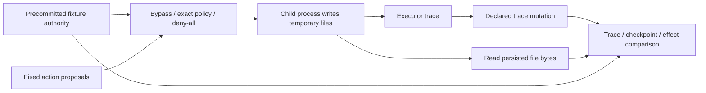

# Real-effects assurance lab

This experiment measures whether exact-action permissions prevent unauthorized disposable file
writes and whether evidence comparisons detect altered execution traces. It extends the earlier
simulated instrument with actual disk effects. It does not implement a production agent gateway.

The [industry gap map](INDUSTRY_GAPS.md) connects this work to public OpenAI, Anthropic, Google,
Microsoft, AWS and other guidance, with prior art and concrete remaining milestones. The
[design](../superpowers/specs/2026-10-15-assurance-lab.md) declares the scope and gate lifecycle.

The later [incident scope experiment](scope/README.md) tests exact HTTP request permissions and
durable stops in 54 local rows. Its [2026 incident review](scope/INCIDENT_RESEARCH.md) distinguishes
the Hugging Face and Medicare accounts, maps additional OpenAI disclosures, and records the
approved-service relay gap that remains outside the broker's enforcement boundary.
The [kernel egress extension](egress/README.md) applies an additional Linux profile inside that
service and measures eight blocked network channels across 36 case/control rows. The broker stays
unchanged; filesystem communication remains outside the new profile's claim.

The [descriptor isolation extension](isolation/README.md) adds a separate profile that denies new
filesystem/IPC access while retaining approved file handles and connected TCP peers. Its 57 rows
include useful work, twelve blocked attack baselines and approved-channel content failures.

## Reproduce

Use Node.js 24 (the tested runtime is 24.19.0) and the repository lockfile. No keys, model calls,
Python dependency or network service is required by this experiment.

```bash
npm ci
npm run test:assurance
npm run assurance:run -- --out /tmp/simurgh-assurance/report.json
npm run assurance:verify -- /tmp/simurgh-assurance/report.json
npm run assurance:verify -- docs/assurance/evidence/report.json
```

Use a fresh output path; existing reports are never overwritten. Without `--out`, the runner
creates a unique temporary report directory. Sink directories are removed when each case closes.
Unexpected worker/request errors fail the run. The two intentional faults are explicitly recorded.
The saved [report](evidence/report.json) contains all 51 case/control pairs and source hashes.
The [validation record](VALIDATION.md) lists test counts, review fixes and unrun checks.
Verification executes a fresh matrix and compares the entire parsed report, rejecting missing
cases, changed counts, extra claims and source drift. This establishes reproducibility under the
current implementation, not independent authentication of the historical run. Source changes
require a new report; a valid replay is not itself a proof of safe deployment.

## Executed result — 15 October 2026 UTC

The corpus has three benign workflows, seven authorization attacks, four evidence mutations,
one deliberate no-op mutation and two infrastructure faults. Every control runs every case.
They are authored deterministic fixtures, not independent random samples or model attack rates.

| Enforcement control                     | Authorization attacks with observed forbidden effects / 7 applied | Benign completions / 3 | Unknown cases / 17 |
| --------------------------------------- | ----------------------------------------------------------------: | ---------------------: | -----------------: |
| Bypass (structural validation retained) |                                                                 7 |                      3 |                  2 |
| Exact-action policy                     |                                                                 0 |                      3 |                  2 |
| Deny-all                                |                                                                 0 |                      0 |                  2 |

Each bypass authorization attack produced one forbidden effect. The policy binds run, action id,
principal, tenant, operation, resource, content and policy revision, with one use per grant in a
single session. Substitution, stale revision, a grant added after policy commitment and duplicate
execution are tested. The late grant is added before the action; this does not test retroactive
approval after an effect.
The policy's strings and grants are trusted fixture data, not authenticated human decisions.

| Evidence view, exact-policy control | Detected discrepancies / 4 applied trace mutations | Additional trusted information                   |
| ----------------------------------- | -------------------------------------------------: | ------------------------------------------------ |
| Trace-only policy check             |                                                  0 | None beyond fixture authority and supplied trace |
| Checkpoint comparison               |                                                  4 | Count and digest of sink-observed effects        |
| Full effect reconciliation          |                                                  4 | Full sink-observed effect records                |

Mutations omit the middle event, truncate the suffix, fabricate an authorized but unexecuted
effect, or reorder events. The mutator rewrites sequence numbers, so obvious numbering gaps
cannot make the comparison artificially easy. It cannot change trusted sink data in this model.
The checkpoint and full-observation results are equal: **no advantage over the checkpoint
baseline is demonstrated**. Their greater visibility than trace-only checking explains the result.

The deliberate no-op has `attackApplied: false` in all controls. Deny-all also makes three
trace-deletion/reorder attacks ineffective because no events exist; those mutations are excluded,
leaving only fabrication applied. Observer outage and a killed sink yield `unknown`, with
`forbiddenEffects: null`, under every control. The summary's forbidden-effect total counts only
known observations; read it together with unknown counts. It is not an all-cases safety rate.

## Execution and trust boundary



The sink writes JSON effect records for synthetic patch/report operations. It does not patch a
real project or send a report to a real service. The observer reads the files rather than accepting
the executor's returned objects. Tests inspect files directly and mutate stored bytes to confirm
read-back follows disk state. Resource names are a fixed enum and never become filesystem paths.
The child inherits no environment credentials and executes no caller-supplied shell command.

The enforcement and scoring code use separate decision paths but share schema/canonicalization
and the same host. Process separation is useful for this experiment; it is not a security sandbox
against a malicious host, operator or worker. The disk snapshot does not observe transient reads,
network activity or effects outside these files. Sink output and its checkpoint are trusted
within the experiment; a local hash supplies no external identity or operator independence.

## What remains open

- The [SDK extension](sdk/README.md) now exercises pinned OpenAI Agents SDK and LangGraph
  pause/resume/reject flows and LangGraph edits; OpenAI in-place editing is explicitly unsupported.
  Realistic multi-turn connector workloads and durable framework recovery remain open.
- The [durability extension](durable/README.md) now tests local process-crash recovery and
  concurrent workers with an idempotent sink. Distributed recovery, power-loss behavior,
  end-to-end SDK workflow recovery and revocation remain open.
- Verified enterprise principals, tenant credentials, human approvals and independent custody.
- Held-out attacks, real connector workloads, external reproduction and measured overhead.
- Deployment-specific threat modeling and remediation of the disclosed [legacy reuse blockers](../openai/SECURITY_REVIEW.md).

No historical stage coverage, signed artifact or release status changes. This is an implemented,
executed local instrument milestone; the remaining work is not represented as complete.
