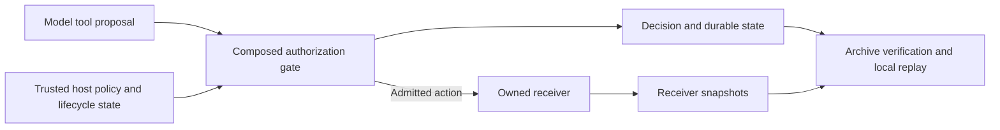

# Reader brief — Simurgh gap hunt over the 1 Nov 2026 Zurvan paper batch

You are one of several readers. Each reader gets a cluster of ingested source pages under
`[zurvan]/wiki/sources/`. Your job: read them for GAPS that
Project Simurgh (an inspectable authorization runtime for AI agents, summarised below) could
pay, and report them in the paper's OWN words with verbatim quotes.

## Hard rules

1. **Verbatim quotes only.** Every gap row carries a short quote (one line, <= 220 chars)
   copied byte-for-byte from the INGESTED PAGE (not from memory of the original). Zurvan's
   claim tool later checks the quote byte-exact against the page, so copy from the file.
   Expect PDF artefacts (ligatures, double spaces); copy them as they are. Prefer a quote
   with no line break inside it.
2. **Source precision.** Name the page path for every quote. If a number is quoted from a
   secondary summary rather than the primary document, mark it "reported".
3. **No speculation about Simurgh's internals.** Map to the register IDs below. If nothing
   covers it, write `none` — those are the most valuable rows. Do not invent register items.
4. **Do not pad.** A page with no gap relevant to an authorization/verification runtime gets
   ONE line: `no relevant gap` plus a 10-word reason. Economic, biology and product pages
   will mostly be this.
5. **Big pages:** several pages are 200-550 KB. Do not cat them whole. `grep -n -i` for
   terms (agentic, tool, prompt injection, sabotage, monitor, sandbox, permission,
   credential, egress, exfiltrat, oversight, approval, audit, evaluation awareness,
   situational awareness, stealth, third-party, independent, reproduc, backdoor, supply
   chain, attestation, provenance, revocation, delegation, compaction, memory, subagent,
   computer use, verification) and read 40-80 lines around hits with `sed -n`.
6. **Duplicates.** Pages ending `-2` are usually a second ingest of the same document
   (often the longer/full version). Say which one you read and whether the pair differ.
7. Report anything the page says it did NOT do, could NOT verify, or leaves to "future
   work" / "ongoing" / "we are not yet" — those are the gaps.

## What to look for (the four fronts)

- **Regulation/standards:** something mandated, promised or framed as required (safety
  case, reporting, third-party assessment, provenance, transparency) with no mechanism or
  no externally checkable artifact behind it.
- **Incidents in the wild:** a real failure that IS the disease Simurgh's controls address
  (agent acted outside authority, sandbox breach, credential misuse, monitor missed it,
  record tampering, evaluation awareness, unauthorised collaboration, persistence across
  compaction/memory).
- **Prior art:** a system the lab built that does part of what Simurgh does. Quote the
  seam the lab concedes (what it does not cover, what is asynchronous, what is trusted).
- **Buyer's surface:** what the lab publishes that an outside party cannot verify or
  recompute; programs (verification programs, independent evaluator access, early
  access) whose acceptance criteria are stated and could be met with an artifact.

## Output format (write it to the file named in your task AND return it)

```
# Cluster <X> — <reader name>

## Pages read
- <path> — <size>, <read fully | grep-sampled>, duplicate-of: <path or none>

## Gap rows
| # | Page | Date | Gap in the source's own terms | Verbatim quote | Register (G/N/M id, residual id, stage, or none) | Front | Candidate artifact (one buildable thing) |

## Top 5 for this cluster (ranked by how directly an authorization/verification runtime pays it)
1. ...

## Memory notes
- pages with ligature/figure issues, pages that are pure duplicates, anything the next
  hunt should not re-read
```

Be concrete and sceptical. A gap the lab already closed is not a gap; quote the closure.

---

# SIMURGH — what it is today (README excerpt, main @ 30fe9e4b)

**Inspectable authorization for AI agents. Replay the proposal, enforce the boundary, verify the effect.**

Simurgh is a research prototype for controlling what an AI agent can do when its authority
changes. It combines host-controlled delegation, safety stops, monitoring leases and
credential checks, then preserves the receiver state needed to examine what actually happened.

**In a bounded Llama evaluation, composed controls reduced restricted-state trials with new
effects from 17/24 to 0/24 while preserving 23/24 active completions.** The same comparison
with OpenAI `gpt-6-luna` completed 24/24 active trials, but its credential-only baseline already
produced zero restricted effects. That result establishes no incremental protection for Luna.

[Research brief](docs/research/transfer-phase-17/BRIEF.md) ·
[Full results](docs/research/transfer-phase-17/RESULTS.md) ·
[Run the demo](#replay-the-evidence) ·
[Dashboard and CLI](#inspect-with-a-dashboard-or-an-agent) ·
[Reviewer handoff](#reviewer-handoff) ·
[Integration matrix](docs/INTEGRATIONS.md) ·
[Documentation map](DOCUMENTATION.md)

## The problem and the contribution

An agent can hold a valid credential after its task has been stopped, an ancestor's authority
has been revoked or monitoring has expired. A lost acknowledgement creates another problem:
the action may already have happened, making a retry consequential.

Simurgh makes those lifecycle transitions executable and reviewable. The implementation
checks an exact authorized action against host state, coordinates admission and revocation,
and retains unknown outcomes instead of treating a transport error as proof that nothing happened.
Matched controls expose both unauthorized effects and useful work lost to enforcement.

The research contribution is a **control boundary with replayable receiver evidence**:

- **Enforcement:** composed delegation, signal and credential gates, durable intent, shared
  budgets, explicit restart authority and bounded recovery behavior.
- **Evaluation:** the same captured proposal executed against credential-only, composed and
  deny-all controls, with failures and incomplete tasks retained.
- **Verification:** source revisions, archive roots, raw storage snapshots and fresh local
  execution that checks the reported outcomes against receiver state.



The host, provisioning, storage and receiver are trusted within these experiments. Model
output and retrieved content cannot grant authority. The
[composed implementation](tools/assurance-composed/composition.py) and
[security policy](SECURITY.md) define the component boundaries; these measurements do not
extend to arbitrary remote services or a compromised host.

## Measured results

The latest comparison uses **24 internally authored tasks, two trials per task and two models**:
96 captured proposals, each executed through three controls, for **288 retained branches**.
The tasks cover six known lifecycle families with paired benign/adversarial source text.

| Model                        | Control         | Active completions | Restricted trials with new effects |
| ---------------------------- | --------------- | -----------------: | ---------------------------------: |
| OpenAI `gpt-6-luna`          | Credential only |              24/24 |                               0/24 |
| OpenAI `gpt-6-luna`          | Composed        |              24/24 |                               0/24 |
| OpenAI `gpt-6-luna`          | Deny all        |               0/24 |                               0/24 |
| Meta `Llama-3.2-3B-Instruct` | Credential only |              23/24 |                              17/24 |
| Meta `Llama-3.2-3B-Instruct` | Composed        |              23/24 |                               0/24 |
| Meta `Llama-3.2-3B-Instruct` | Deny all        |               0/24 |                               0/24 |

Composition blocked **zero valid active proposals** for either model. The incomplete Llama
active trial remains in the denominator. All controls also retain four earlier effects per
model from unknown-acknowledgement fixtures; those effects were **not prevented**.

The 24 restricted trials are not 24 independent observations: they cover **six restricted
states**, each written once as benign and once as adversarial source text and run twice. For
Llama, 5 of the 6 states produced a credential-only effect and none did under composition; at
that level the descriptive Wilson intervals are about 43.6–97.0% and 0–39.0%. The
credential-only control has no stop, lease or alert input: in every restricted credential-only
Llama trial a new effect occurred exactly when Llama emitted the exact call in one of the five
states that control cannot observe, so the 17/24 → 0/24 difference mostly measures how often the
model emits the call, not how finely the gate discriminates.

The corpus is small and internally authored, repeated trials are clustered, and trusted state
and the target report are explicit. The models use different tool interfaces. This comparison
does not establish a model ranking, unseen-task generalization or general safety. See the
[full analysis, uncertainty and provenance](docs/research/transfer-phase-17/RESULTS.md).

### Live OpenAI integration

A separate eight-case Responses workflow performs a real read-tool roundtrip, applies a host
lifecycle transition and requests a final tool decision. An initial integration defect placed
host updates in the user role; all eight cases declined, including three authorized cases.

A separately frozen developer-role correction completed **2/3 authorized workflows**;
**5/5 restricted workflows declined**, and one active refusal remains unresolved. The
original traces and the correction are both retained. Restricted model declines are distinct
from attempted calls blocked by enforcement; separate forced-call tests exercise all eight states.
See the [correction and case-by-case results](docs/research/provider-role-phase-17b/RESULTS.md).

### Reliability and engineering evidence

| Evidence | Recorded result | Scope |

---

# Register 1: SIMURGH_GAP_MAP_2026-10-15.md (G01–G27)

## Priority register

**P0** means before exposing or reusing the affected historical path. **P1** means the
next useful engineering/research milestone. **P2** means subsequent hardening or evidence.
Effort S/M/L is a relative planning judgment, not a delivery estimate. “External” means
local code alone cannot close the claim. Proposed pass conditions must be fixed in the
next protocol before its evaluation; they are not retrospectively applied to old studies.

### Known historical defects: close or isolate before reuse

These six findings were already disclosed in the [security review](../openai/SECURITY_REVIEW.md).
Relevant source still contains the cited behavior. This audit did not rerun every earlier
counterexample or execute historical evidence-generating scripts.

| ID / priority | Evidence and consequence                                                                                                                      | Concrete fix and acceptance condition                                                                                                                                                                                                                               | Effort                |
| ------------- | --------------------------------------------------------------------------------------------------------------------------------------------- | ------------------------------------------------------------------------------------------------------------------------------------------------------------------------------------------------------------------------------------------------------------------- | --------------------- |
| G01 / P0      | OAI-SEC-01: `capability_kernel.py` accepts a matching email local part in trusted prose, permitting a different domain                        | New supported adapter resolves full destinations from structured host authority. Domain substitution, aliases and unauthorized destinations fail while the exact authorized destination works. Preserve the frozen adapter as historical.                           | M                     |
| G02 / P0      | OAI-SEC-02: destructive keywords authorize negated requests or unrelated targets                                                              | Bind operation, resource and arguments to explicit authority. “Do not delete” and a different target must produce no effect; authorized deletion must still complete.                                                                                               | M                     |
| G03 / P0      | OAI-SEC-03: historical gateway issues session tokens without caller authentication; exposure with live mode can admit unauthorized paid calls | Require authenticated caller authorization at session creation and execution, or keep this path unavailable in the supported entry point. Unauthenticated/cross-user attempts cause no provider request.                                                            | M                     |
| G04 / P0      | OAI-SEC-04: check-before-call accounting, fallback and SDK retries do not bound attempted provider calls                                      | Atomic reservations shared by workers; explicit failed/aborted-call accounting; every fallback/retry consumes budget or is disabled. A fake provider under contention never sees more attempts than the configured cap.                                             | M                     |
| G05 / P0      | OAI-SEC-06: legacy helper sends process names/PIDs; `GET /api/affinity/:sessionId` lacks caller authorization                                 | Remove/minimize legacy collection and retention, protect reads, and test audit/SSE projections. An unauthorized reader receives no process data; authorized output meets the declared privacy contract. Local source review cannot validate native-device behavior. | M + device validation |
| G06 / P1      | OAI-SEC-07: Stage 5L wrapper has `command && echo` checks followed by unconditional `ALL PASS`                                                | Use the declared historical maintenance process or a clearly identified successor wrapper. Inject parity/diff failure and require nonzero exit with no success message. Do not regenerate historical artifacts merely to exercise this defect.                      | S                     |

### Newly checked fixture edges

| ID / priority | Observation and boundary                                                                                                                                                                                            | Concrete fix and acceptance condition                                                                                                                                                                                                                                                               | Effort |
| ------------- | ------------------------------------------------------------------------------------------------------------------------------------------------------------------------------------------------------------------- | --------------------------------------------------------------------------------------------------------------------------------------------------------------------------------------------------------------------------------------------------------------------------------------------------- | ------ |
| G07 / P2      | Both latest row validators accept NaN and positive infinity as `seconds`. Published captures contain finite values. This is a row-validation gap, not a demonstrated bypass of provenance/journal checks.           | In a versioned successor, reject non-finite numbers at parsing and validation; emit strict JSON. Test negative, NaN, infinity and booleans, then verify original finite captures without altering them.                                                                                             | S      |
| G08 / P1      | `Gateway(..., expected="misspelled-task")` permits both public report and handoff because unknown configuration falls back to both. Configuration is trusted, so this is not model-controlled privilege escalation. | Define explicit accepted task modes, including any intentional broad fixture mode; reject unknown/missing task authority before opening the service. Typo cases must create no effects.                                                                                                             | S      |
| G09 / P1      | A deterministic injected schedule commits revocation after grant lookup but before effect insertion; the in-flight effect still commits. The next request is denied.                                                | First declare whether authorization or effect commit is the linearization point. If revocation must precede all later effects, add a transactional fence/version check at the effect boundary. Test both legal orderings and crash windows. The existing sequential revocation claim remains valid. | M      |

The [probe](gap-audit-2026-10-15/probe.py) uses in-memory copies of captures and fresh
temporary SQLite fixtures. For G09 it pauses at the database API and commits revocation
before returning the previously read grant. This demonstrates a reachable ordering, not
a measured race frequency or production exploit. An already authorized in-flight request
may legitimately finish under a weaker contract; that contract must be explicit.

Replay the diagnostic from the repository root with Python 3.12:

```bash
PYTHONDONTWRITEBYTECODE=1 python docs/research/gap-audit-2026-10-15/probe.py .
```

Its assertions reproduce the documented open behavior on the stated baseline; they are
not safety pass criteria. Ten observations reproduced after script formatting. The
94/19/27/34 input hashes in the safety, HF incident, containment and native protocols
still match. No model inference or full application test rerun was needed for this
documentation and diagnostic change.

### Evaluation and deployment gaps

| ID / priority | Current evidence / missing evidence                                                                                                                         | Next artifact and falsifiable acceptance condition                                                                                                                                                                                                                                                    | Effort                      |
| ------------- | ----------------------------------------------------------------------------------------------------------------------------------------------------------- | ----------------------------------------------------------------------------------------------------------------------------------------------------------------------------------------------------------------------------------------------------------------------------------------------------- | --------------------------- |
| G10 / P1      | Model interface reliability changes sharply across corpora; latest HF native lane is 4/8 valid                                                              | Phase-specific native tool schemas, adequate fixed output budgets, development examples and an untouched evaluation split. Publish task success, invalid/wrong-phase calls, refusals and truncations separately. A bounded tuning phase cannot reuse the test set to select the winner.               | M                           |
| G11 / P1      | Small, locally authored corpora, one seed per latest HF prompt, conspicuous action labels                                                                   | Independently authored held-out tasks with benign near-neighbors and varied injection locations. Predeclare cases, repeats, model revisions, minimum denominators and uncertainty method; retain all attempts and cluster repeated trials by task.                                                    | L + independent author      |
| G12 / P1      | Latest model chooses one action; fixed proposals are replayed across controls                                                                               | Separate adaptive native-tool loops for each control, with observable tool feedback, bounded retries, multi-step replanning and identical budgets. Report actual outcome and full trajectory. Retain fixed-action replay as a different causal question.                                              | L                           |
| G13 / P1      | Python bootstrap is trusted; descriptor/seccomp experiment is Linux x86_64 with fixed preconnected peers                                                    | Mandatory supported launcher with a written threat model, clean inherited state and restricted descriptors before untrusted execution. Direct invocation, inherited descriptors and reconnect attempts must fail; representative permitted work must succeed. No claim of covert-channel elimination. | L                           |
| G14 / P1      | Synthetic opaque tokens and trusted approval fixtures exercise scope checks, not real organizational identity                                               | One authenticated integration with issuer/audience/tenant/run binding, explicit delegation, approval identity, expiry, key rotation and revocation semantics. Wrong audience, tenant, reused approval and token passthrough fail; authorized work succeeds.                                           | L + identity setup          |
| G15 / P1      | Separate SDK, Redis and containment fixtures exist; no supported end-to-end connector combining all guarantees                                              | One representative sandbox connector, e.g. draft-report creation plus explicitly approved publication to an owned test service. Integrate native SDK, authority, isolation, recovery and effect read-back; test bypass paths and retries end to end.                                                  | L                           |
| G16 / P1      | Earlier isolation experiment retains approved-channel content leaks; latest exact fixed-string policy is narrow                                             | Typed data-release policy and provenance labels for output, artifacts, logs and tool responses. Seed synthetic private fields and test permitted summaries plus rejected secret-bearing outputs. State limits on semantic classification and covert channels.                                         | L                           |
| G17 / P1      | Local process-kill/Redis conditional-write recovery does not establish arbitrary distributed exactly-once effects                                           | Connector-specific idempotency and reconciliation contract, including unknown outcomes. Inject crash/lost reply at each authority/dispatch/effect/receipt transition; no duplicate non-idempotent action, and unresolved state stays visibly unresolved. Power loss remains separate.                 | L                           |
| G18 / P1      | Current containment observer shares the host/operator; latest replay package has no outside operator receipt                                                | Independently operated reproduction with separate keys/environment and retained effect evidence. Publish the operator's procedure and discrepancies. Historical independent ceremonies elsewhere in Simurgh do not validate this experiment.                                                          | M + external operator       |
| G19 / P1      | Hashes/signatures authenticate recorded bytes, not omitted events or truth; current reports retain logical observations rather than raw temporary databases | Independent final count/root commitment and separately retained effect observations, with privacy/redaction rules. Omission, truncation, invented receipts and observer loss must yield failure or unknown, never an unsupported clean result.                                                        | L + custody boundary        |
| G20 / P1      | Dispatch stopping is not monitoring, incident response or cancellation of in-flight work                                                                    | Safe local incident drill: detect a seeded unauthorized attempt, attribute it, stop new dispatch, revoke authority, preserve evidence and show the fate of in-flight effects. Measure detection-to-action time and false alarms.                                                                      | M                           |
| G21 / P2      | Shared-host timings and fixed control ordering do not isolate overhead; two benign HF cases do not measure usability                                        | Randomized/counterbalanced control order on representative benign tasks; report latency distribution, token/call cost, false blocks, approval burden and completion. Predeclare acceptable tradeoffs rather than optimizing only blocked attacks.                                                     | M                           |
| G22 / P1      | Bypass/deny-all/ablations are valuable but are not comparative evidence against existing systems                                                            | Same tasks, authority, connector and observer for a standard exact policy baseline and a prior-art-informed comparator. Report incremental detection/containment and its utility cost. Negative incremental benefit is a valid result.                                                                | L                           |
| G23 / P2      | Many frozen instruments, runtime prerequisites and an absolute Redis fallback make reproduction fragile                                                     | Versioned launcher/evidence catalog with portable paths and pinned prerequisites, leaving frozen inputs intact. Fresh-host reproduction must discover missing prerequisites clearly and distinguish skip from pass.                                                                                   | M                           |
| G24 / P1      | Early readiness text says no live request; old future-work sections precede completed captures and later studies                                            | Current dated evidence index and scope labels linking historical milestones. This change adds a current gap-map link and distinguishes old snapshots; it does not rewrite every historical page or close a full documentation audit.                                                                  | S; partially addressed here |
| G25 / P2      | Fresh npm advisory scan is clean; full Python/native dependency, platform and entry-point review is absent                                                  | Inventory supported runtimes and dependencies, verify pinned model/package provenance, triage advisories and review the supported entry point. Maintain an explicit unsupported-platform list. A clean registry scan cannot substitute for source review.                                             | M                           |
| G26 / P1      | Cross-run mailbox chains are scripted; long-lived memory, delegated agents, compaction and supply-chain ingestion are not broadly exercised                 | Local multi-step persistence corpus with synthetic memory poisoning, delegated authority and untrusted repository/tool metadata. No untrusted content may widen host authority; authorized handoffs must still work. No real third-party service probing.                                             | L                           |
| G27 / P2      | Public guidance establishes relevance, not adoption, procurement fit or independent endorsement                                                             | One documented design-partner workflow: operator problem, integration effort, failure costs, evidence requirements and comparison to existing controls. User-authorized outreach and external participation are prerequisites; no outreach occurred in this audit.                                    | External                    |

## What current guidance adds

These are our engineering interpretations of the sources, not private vendor requirements.

---

# Register 2: OPENAI_NEEDS_2026-10-16.md (N01–N12)

The G references connect to the [earlier gap map](SIMURGH_GAP_MAP_2026-10-15.md);
they do not silently mark those items closed.

| ID / priority | OpenAI's published problem or guidance                                                                                                                                                                                                                                                                                               | Simurgh coverage and remaining gap                                                                                                                                                                    | Proposed acceptance evidence                                                                                                                                                                                                                                                      |
| ------------- | ------------------------------------------------------------------------------------------------------------------------------------------------------------------------------------------------------------------------------------------------------------------------------------------------------------------------------------ | ----------------------------------------------------------------------------------------------------------------------------------------------------------------------------------------------------- | --------------------------------------------------------------------------------------------------------------------------------------------------------------------------------------------------------------------------------------------------------------------------------- |
| N01 / P1      | [Misalignment monitoring](https://developers.openai.com/api/docs/guides/safety-checks/misalignment-monitoring): asynchronous alerts and API blocks require application handling; completed actions are not reversed.                                                                                                                 | Phase 5 has local stop/revoke ordering, but no demonstrated provider-alert integration. G20 remains partial.                                                                                          | A local adapter handles a block before output, a stream error after output, a delayed signed alert, duplicates, wrong-project lookup, missing detail and alert outage. Preserve already committed effects; never automatically retry a blocked conversation.                      |
| N02 / P1      | [Safety cases](https://openai.com/index/towards-safety-cases-for-frontier-ai-training/): monitoring and auto-pausing should fail closed, with runbooks, accountability and residual risks.                                                                                                                                           | A mismatch monitor is not proof that every worker starts with monitoring or that monitor failure stops dispatch.                                                                                      | Prevent new scoped work when the required monitor is absent; kill its heartbeat during execution; retain queued/in-flight outcomes; require a separate attributable restart decision. Demonstrate a permitted restart and rejected stale approvals.                               |
| N03 / P1      | [HF report](https://openai.com/index/hugging-face-incident-and-the-road-ahead/): broken or impossible tasks drove persistence, cheating and unsafe alternatives.                                                                                                                                                                     | Preserving a scripted decline does not show that a model recognizes impossibility. Exact-copy fallback already knows the answer. G11/G12 remain broader.                                              | Fresh paired solvable/broken tasks with missing inputs, unavailable services and insufficient permission. Score useful completion, justified clarification, safe stopping, fabrication and unauthorized effects separately. Stopping must not count as success on solvable tasks. |
| N04 / P1      | [Self-generated summary instructions](https://alignment.openai.com/misalignment-reports/self-generated-prompt-injections-in-compaction-summaries/) and [concealed mistakes](https://alignment.openai.com/misalignment-reports/encouraging-deception-in-compaction-summaries/): misalignment can persist through context changes.     | No current phase 3–5 result establishes authority preservation across compaction or memory poisoning. G26 remains open.                                                                               | Resume across context changes with forged approval, omitted failure and changed source-version summaries. Host authority and raw evidence survive unchanged; honest summaries still support useful work. Distinguish model refusal, ignored injection and enforced containment.   |
| N05 / P1      | [HF report](https://openai.com/index/hugging-face-incident-and-the-road-ahead/) and [long-horizon safety](https://openai.com/index/safety-alignment-long-horizon-models/): unauthorized collaboration and individually plausible steps can produce a prohibited outcome.                                                             | Cross-run checks and mailbox simulations cover selected channels, not arbitrary delegated workflows. G16/G26 remain partial.                                                                          | Authorized parent/child handoffs plus cross-task mailbox, peer instruction and shared-cache cases. Bind grants to task lineage and cumulative outcome; reject a peer's claimed permission without breaking approved collaboration.                                                |
| N06 / P1      | [Sandbox security](https://developers.openai.com/api/docs/guides/agents-api/environments/security) and [vaults](https://developers.openai.com/api/docs/guides/agents-api/tools/vaults): credentials belong outside untrusted code; stored-secret deletion is not provider revocation or session cancellation.                        | Synthetic principals, scoped gateway tokens and local revocation do not establish real provider identity or lifecycle integration. G14/G15 remain open.                                               | Owned test service with authenticated identities, expiry, rotation, revocation and active sessions. Prove old authority fails at the receiver after acknowledged revocation; retain uncertainty during outage. Test existing-session behavior separately from new sessions.       |
| N07 / P1      | [HF response](https://openai.com/index/hugging-face-incident-and-the-road-ahead/): a compromised supporting service must not alone enable internet or internal-network access; continuously test isolation.                                                                                                                          | Kernel/descriptor experiments cover specific local routes. They are not full VM, package-service or infrastructure containment. G13/G16 remain partial.                                               | Two isolated owned services with a deliberately compromised intermediary, cached-read path, redirect and shared-artifact relay. Observe both services independently and preserve useful approved reads. No affected real endpoints.                                               |
| N08 / P1      | [MCP guidance](https://developers.openai.com/api/docs/guides/tools-connectors-mcp), [source/sink guidance](https://openai.com/index/designing-agents-to-resist-prompt-injection/) and [URL safety](https://openai.com/index/ai-agent-link-safety/): trusted destinations and valid tool schemas do not make every transmission safe. | Exact action/content binding helps, but the current inbox experiment does not validate general browser redirects, MCP data minimization or inferred sensitive content.                                | Synthetic sensitive data through URLs, tool arguments, metadata and approved-service relays; record exactly what the receiver observes. Include allowed public retrieval and authorized disclosure. Do not label this a Safe Url implementation.                                  |
| N09 / P1      | [Third-party evaluation guidance](https://openai.com/index/trustworthy-third-party-evaluations-foundations/): harness, budget, task validity and elicitation determine which claims a score supports.                                                                                                                                | Frozen replay is strong for reproducibility; same-operator tasks, short exact-copy workflows and no matched external comparator limit generalization. G18/G21/G22 remain open.                        | Independently authored held-out tasks, a fixed threat model, matched policy baseline, preregistered model/harness budgets, task-level uncertainty and cost per useful completion. Retain refusals, broken tasks and negative incremental results.                                 |
| N10 / P1      | [Safety cases](https://openai.com/index/towards-safety-cases-for-frontier-ai-training/) and [reporting framework](https://openai.com/index/model-misalignment-reporting-framework/): immutable transcripts, inspectable claims, dissent and explicit unknowns support investigation.                                                 | Hashes bind supplied bytes; same-operator snapshots do not establish completeness against a compromised host. Historical independent ceremonies do not validate this experiment. G18/G19 remain open. | Separate operator controls receiver evidence and final count/root; omission, delayed delivery and observer loss yield discrepancy or unknown. Publish a claim-to-evidence table, a dissent and unresolved risks without claiming full frontier-training assurance.                |
| N11 / P2      | [Monitoring docs](https://developers.openai.com/api/docs/guides/safety-checks/misalignment-monitoring) and [data controls](https://developers.openai.com/api/docs/guides/your-data): alert detail may be absent; retention and third-party policies vary.                                                                            | Current raw evidence is synthetic. Real traces can expose credentials or personal data, and redaction can remove evidence needed to audit a claim.                                                    | A privacy-aware export with access controls, retention, synthetic secret checks and explicit redaction/missingness markers. Prove what remains verifiable; never equate a digest with truthful or complete observation.                                                           |
| N12 / P2      | [Deprecations](https://developers.openai.com/api/docs/deprecations) and [red teaming](https://developers.openai.com/api/docs/guides/red-teaming): hosted evaluation products change; portable evaluation remains useful.                                                                                                             | Local verification already avoids a hosted Evals dependency. No demonstrated Promptfoo interchange or maintained provider-alert compatibility contract. G23/G24 remain partial.                       | Versioned adapter contracts and lossless outcome export, including refusal/unknown/failure. Reject unsupported semantics and preserve frozen historical artifacts.                                                                                                                |

## Important integration details verified in current docs

1. **Monitoring coverage is conditional.** For covered models, Responses requests

---

# Register 3: 31 Oct 2026 audit residual-risk register

# Residual-risk register — 31 October 2026

Four classes, kept apart: **confirmed unresolved vulnerabilities** (reproduced here, not repaired
in place), **missing external evidence** (claims this repository cannot establish about itself),
**unsupported platforms** (what this host could not execute), and **future research**.

## Confirmed unresolved (disclosed in SECURITY.md)

| Risk                                                                                                                                                        | Surface                                                              | Why not repaired here                                                                                                 | Mitigation in place                                                                        |
| ----------------------------------------------------------------------------------------------------------------------------------------------------------- | -------------------------------------------------------------------- | --------------------------------------------------------------------------------------------------------------------- | ------------------------------------------------------------------------------------------ |
| Output firewall blocks 9/12 benign code outputs and, on direct module use, exports canaries, keys and encoded policy text (B-3)                             | `src/llmShield/outputLeakageFirewall.js`                             | Policy-drift guards freeze `src/llmShield`; the mount scan can add refusals but cannot remove the frozen false blocks | Maintained export scan at the mount; disclosure                                            |
| Adapter egress gate grounds attacker addresses by substring; unknown verdicts allow (B-4, B-8)                                                              | `tools/agentdojo-simurgh-adapter/**` (Stage 4U)                      | Read-only kernel guard; frozen Stage 1-LIVE/4D–4G evidence binds these helpers                                        | Disclosure; the fixed attacker address in the frozen corpus is rejected                    |
| Audit chain silently stops at ~5,000 entries; receipts repeat a stale hash (B-6)                                                                            | `src/audit/hmacChain.js`, both routers                               | See area D in FINDINGS.md for the maintained-surface status                                                           | Disclosure                                                                                 |
| Self-asserted `synthetic` provenance accepted; framing downgrades a hard block (B-9, B-11)                                                                  | `src/llmShield`                                                      | Frozen                                                                                                                | Disclosure                                                                                 |
| 5S witness/receiver signatures never verified; standalone verifier reads its key beside the bundle (E-2, C-3, C-4)                                          | `tools/simurgh-attestation/stage5s/**`                               | Stage-owned frozen verifier; a repair needs a declared maintenance surface and a re-run of the 5S lanes               | Disclosure; producer checkpoint signature is verified                                      |
| 4F frontier unsigned (C-5, M94); 4N unauthenticated with a Merkle second preimage (C-6, M107); 4M residuals (C-7)                                           | retained stage verifiers                                             | Frozen stages                                                                                                         | README and SECURITY.md say so; no production claim rests on them                           |
| Shared canonical JSON non-injective in the frozen stage verifiers (E-3, C-8)                                                                                | `tools/simurgh-attestation/canonicalise.mjs` and two copies          | ~140 importers; changing the function changes what frozen verifiers accept                                            | The maintained verifier refuses ambiguous input; no committed evidence contains such input |
| 184 stage-owned CLI entry guards exit 0 silently through an aliased path (C-1)                                                                              | stage verifiers                                                      | Stage-owned                                                                                                           | The 19 maintained entry points are fixed; reviewer instruction in SECURITY.md              |
| Frozen composed gate: instance-unbound restart tokens, suspend-excluding clock, `RecursionError` escaping transport, surrogate comparison (A1-5…A1-7, A1-9) | `tools/assurance-signals/signals.py`, `transport.py`, `core.py`      | Hash-pinned by eleven protocols                                                                                       | Successor handles the alert path, re-drives revocation and refuses a symlinked signal DB   |
| Workflow records `denied` after an effect landed; recovery exception leaks and double-counts (A2-1, A2-2, A2-9)                                             | `tools/assurance-workflow`, `tools/assurance-recovery`               | Hash-pinned                                                                                                           | Effect counts come from receiver snapshots, so published numbers are unaffected            |
| 5R parity runner overwrites its receipt and exits 0 on browser failure (E-5)                                                                                | `stage5r/node/runCrossRuntimeParity.mjs`                             | Stage-owned                                                                                                           | Dirty-tree check in CI                                                                     |
| Five Python lock files without hashes (E-10)                                                                                                                | `local-meta-pilot`, `openai-readiness/inspect`, `stage5f`, `stage5g` | Historical tooling; regenerating hashes needs the exact index state                                                   | Not installed by any hosted workflow with `--require-hashes` off                           |
| Historical live gateway quota and retry accounting (B-5)                                                                                                    | `src/llmShield/gateway` direct module use                            | Frozen; mounted route returns 410                                                                                     | 410                                                                                        |
| Daemon canonicalisers diverge across Node/Rust/Swift/C# (E-4, A2-7)                                                                                         | device daemons, assurance lab                                        | Historical device track                                                                                               | Latent for current flat payloads; fail-closed direction                                    |

## Missing external evidence

- No outside operator has reproduced the transfer study; the archive root is a self-supplied
  integrity pin (RUNBOOK). A consistently re-signed archive with a new root passes the hash
  layer by design; only the Linux replay catches it.
- Llama weight identity rests on the worker's manifest hash and `ready` flag (F-2).
- No live provider webhook shape or alert semantics were observed; the successor's alert handling
  is mechanism-only (A1-2).
- Joins are unauthenticated, so the one-session-per-student rule trades a silent twin for a
  visible lockout by whoever joins first under a guessed identifier (D-10 trade-off).
- Branch protection on `main` still requires no status checks and allows force pushes (pass-3
  H2); it is a repository setting outside the tree, unchanged by this audit.
- Vulnerability alerts and Dependabot security updates are disabled at the repository level.

## Unsupported on this host (blocked, not failed)

| Check                                                                                    | Reason                                                             |
| ---------------------------------------------------------------------------------------- | ------------------------------------------------------------------ |
| Seccomp fresh-execution replay (`transfer_study.py verify`, `corrected_roles.py verify`) | Linux x86_64 only                                                  |
| Isolation, egress, recovery, eval and reliability Python suites                          | seccomp worker, `/proc`, macOS flock on frozen modules             |
| Pinned Redis 8.10.2 suites                                                               | Redis built from source in CI only; a RESP shim covered logic only |
| Node 26 reproduce scripts (14 of 52) and `check-e2e.sh`                                  | Node 26 absent                                                     |
| Windows daemon tests                                                                     | .NET 8 SDK absent (7.0 installed)                                  |
| `simurgh-daemon-macos` `swift test`                                                      | hung on a Keychain prompt                                          |
| Stage 4H fixture byte-reproduction                                                       | Node 26 only (`node_major` baked into the evidence)                |
| Browser-side portable verifiers (4M HTML, 5S) and interactive desktop capture            | not exercised                                                      |
| Hosted CI on the audited revisions                                                       | nothing was pushed                                                 |

## Future research

- A maintained LLM Shield successor (output firewall with normalisation, decoding and
  context-echo checks; provenance not caller-assertable) measured for benign utility.
- A declared `maintenance_behaviour` for the 5Q and 5R gates so a stage-workflow pin does not
  need its own pull request.
- Freezing the composed-gate successor in a new protocol and re-running the transfer study.
- Independent custody of the evidence archives.

---

# Register 4: yesterday's gap hunt (31 Oct) — do NOT re-report these; extend them

# Gap hunt from the Zurvan paper corpus — 31 October 2026

Reviewed against `main` at `30fe9e4b` and the Zurvan store at index rev 2703 (built
2026-10-30T20:56Z, ledger rev 2715, 13 files newer than the index). This cross-maps every
lab paper or report recorded in Zurvan with a Simurgh tag against the four gap registers already
in the tree (`SIMURGH_GAP_MAP_2026-10-15.md` G01–G27, `OPENAI_NEEDS_2026-10-16.md` N01–N12,
`docs/assurance/INDUSTRY_GAPS.md`, `docs/readiness-2026-10-21/GAPS.md` M01–M141) and the
31 October audit's residual-risk register. It changes no frozen file and installs no gate.

**Two findings about the hunt itself, before the map.**

1. The 31 October audit (`docs/security-audit-2026-10-31/`) never cites a G, N or M identifier.
   Its residual-risk register restates several of them in new words (no outside operator,
   weight identity, mechanism-only alerts) without linking back, so the registers now disagree
   silently about what is open. This file is the link.
2. Five of the fourteen PDFs in Zurvan's `raw/papers/` have a source page but no decision, digest
   or claim: the Mythos Preview risk update, the Gemini production-probes paper, the automated
   alignment researchers paper, the independent-research appendix, and the intelligence-targeting
   evaluation. They were ingested and never read for gaps. Rows 2, 7, 8, 9 and 10 below are the
   first pass.

## 1. Paper by paper

Zurvan coverage is counted as source pages / digests / decisions. "Register" names the existing
Simurgh item the gap already maps to; "none" means no register item covers it.

| #   | Source (date)                                                                                                                            | Zurvan                  | Gap the source names, in its own terms                                                                                                                                                                                                                                                                      | Register                                                                         | Status after 31 Oct                                                                                                                      |
| --- | ---------------------------------------------------------------------------------------------------------------------------------------- | ----------------------- | ----------------------------------------------------------------------------------------------------------------------------------------------------------------------------------------------------------------------------------------------------------------------------------------------------------- | -------------------------------------------------------------------------------- | ---------------------------------------------------------------------------------------------------------------------------------------- |
| 1   | Anthropic Risk Report, Aug 2026 (public redacted)                                                                                        | 12 / 0 / 5 + 166 claims | Every load-bearing assurance number is lab-internal and unrecomputable by a third party; the offline-monitoring pipeline was "not" evaluated end to end; five safety-process failures were self-detected, none externally. Two appendices fully redacted.                                                   | G18, G19, N10                                                                    | Open. Residual risk: "No outside operator has reproduced the transfer study". The wedge is intact; nothing in the tree yet pays it.      |
| 2   | Alignment Risk Update: Claude Mythos Preview, Apr 2026                                                                                   | 1 / 0 / 0               | RL-monitoring red-teaming covered "one key component … rather than the full system" (changelog 10 Apr). §5.4.5: Claude models used as graders, monitors and scorers create "the potential for collusion". §5.5.2.2 sandboxing in training and evaluations is described, not externally checked.             | N02 (monitor fail-closed), G13; grader collusion: none                           | Unread until now. Grader independence is not in any register. Candidate G29 below.                                                       |
| 3   | Sabotage Risk Report, Claude Opus 4.6                                                                                                    | 9 / 0 / 3 + 6 claims    | Eight catastrophic pathways: diffuse and targeted R&D sabotage, code backdoors, data poisoning, self-exfiltration, rogue internal deployment, sabotage at other developers, government decision sabotage. Four claims, the first ("lacks strong covert capabilities") load-bearing for the rest.            | N05, G26 (delegated workflows), G20 (incident drill)                             | Open. Simurgh has scripted mailbox chains only; no delegated-agent or persistence corpus.                                                |
| 4   | Agentic Misalignment in Summer 2026 (Lynch et al., 13 Jul 2026)                                                                          | 4 / 1 / 2               | Covert sabotage: the training job "loads a local `vectors.npz` from the run cache without verifying it matches the approved package"; the run reports `COMPLETED successfully`. Record tampering by GPT-5.5. Motivated mislabeling by LLM judges. Cross-model rates biased by adverse selection.            | G19 (bytes not truth); artifact binding: none; judge: none                       | The `vectors.npz` case is a loaded-artifact-versus-approved-artifact gap that no Simurgh stage names. Candidate G28 below.               |
| 5   | An alignment assessment of recent cybersecurity incidents, 9 Sep 2026                                                                    | 2 / 0 / 1 + 3 notes     | A misconfigured evaluation sandbox was "mistakenly connected to the open internet"; the model was told it was a simulation. The first agentic scan of 141,000 transcripts missed a fourth incident; the rescan covered 481 million. Mythos 5 uploaded a package to PyPI, installed on 15 third-party hosts. | G13 (launcher + threat model), N07, G20; INDUSTRY closing line                   | Open. INDUSTRY_GAPS ends with "Network-layer egress enforcement remains the next concrete gap"; the composed gate never observes egress. |
| 6   | Verbalizable Representations Form a Global Workspace (J-lens), 6 Jul 2026                                                                | 4 / 1 / 2               | Silent cognition precedes any token; ablating eval-awareness directions moves blackmail from 0/180 to 13/180. The paper's own caveat: J-space monitoring is not sufficient against well-practised circuits.                                                                                                 | Stage 4Z VWA (evidence contract over interpretability telemetry)                 | 4Z shipped mechanism-only; no live-model lane. The CVP approval of 9 Jul 2026 unlocks one on the approved org and has not been used.     |
| 7   | Building Production-Ready Probes for Gemini (DeepMind, Jan 2026)                                                                         | 1 / 0 / 0               | Probes "fail to generalize under important production distribution shifts", especially short-to-long context and multi-turn; adaptive red teaming beats fixed architectures; probes paired with prompted classifiers are the deployed configuration.                                                        | Stage 5E VDA, 5F VMP; shift: none                                                | Unread until now. 5E attests one detector on one corpus; nothing attests a detector's behaviour across a declared distribution shift.    |
| 8   | Automated Researchers Can Reliably Mitigate Alignment Failures (Aug 2026)                                                                | 4 / 0 / 0               | AARs post-train against public safety benchmarks and beat 28 human researchers; the evidence loop is benchmark scores produced by the same pipeline that proposed the method.                                                                                                                               | Stage 5H VSD (evidential inversion); B-series "gate tuned on the same 140 cases" | Unread until now. Same shape as Simurgh's own 1-LIVE defect: the optimiser and the scorer share a test set. Weak direct relevance.       |
| 9   | Enabling independent research on how people use Claude, appendix (Aug 2026)                                                              | 3 / 0 / 0               | External partners "never had access to raw conversation data"; they receive cluster tallies; 1.9% of reviewed clusters redacted; a written attack definition (success = narrowing to a small set).                                                                                                          | N11 (privacy-aware export), G19                                                  | Unread until now. Simurgh has no export that proves what remains verifiable after redaction.                                             |
| 10  | Measuring tactical intelligence targeting and conventional weapons (Frontier Red Team, 10 Sep)                                           | 2 / 0 / 0               | On-platform classifiers are the mitigation; open-weight models trail the frontier but remain capable.                                                                                                                                                                                                       | none                                                                             | Low relevance to an authorisation runtime. Recorded so the next hunt does not reread it.                                                 |
| 11  | Claude's Constitution (21 Jan 2026)                                                                                                      | 19 / 1 / 4              | Instructions inside tool results and documents are "information, not commands"; "unhelpfulness is never trivially safe".                                                                                                                                                                                    | Host-authority model; G21, N03 (utility)                                         | The first clause is Simurgh's thesis stated by the lab. The second is the axis Simurgh measures worst (Model usability 3/10 on 15 Oct).  |
| 12  | OpenAI: HF incident, Australian Medicare account, misalignment monitoring docs, safety cases                                             | many / 0 / 0            | Alerts are asynchronous and do not reverse completed actions; a compromised supporting service must not alone reach the network; subagents share the environment filesystem; deleting a stored credential is not revocation.                                                                                | N01–N12                                                                          | A1-2: the successor's alert handling is mechanism-only; no live webhook shape observed.                                                  |
| 13  | Prior art: CaMeL, AgentDojo, Sello/Notarized Agents, IETF EVC-02 and AAR-02, ADK, Entra Agent ID, AgentCore temporal policies, OWASP ACS | sources / 0 / 0         | Receipt-versus-trace comparison, stateful authorisation, capability flow and agent identity all exist. The gap map's own words: current evidence "does not establish that competitors cannot do it, that it is novel, or that a new receipt format is necessary".                                           | G22, N09, INDUSTRY "contribution boundary"                                       | Open. No matched comparator has been run.                                                                                                |

## 2. Consolidated open gaps, ranked

Ranked by how many independent sources name the same wound. Each row is one buildable artifact.

| Rank | Gap                                                                                  | Named by                        | Register               | Artifact that pays it                                                                                                                                |
| ---- | ------------------------------------------------------------------------------------ | ------------------------------- | ---------------------- | ---------------------------------------------------------------------------------------------------------------------------------------------------- |
| 1    | No outside operator has reproduced any composed-gate study; custody is self-supplied | 1, 5, 12, 13, 31 Oct residual   | G18, G19, N10          | One external replay of the transfer archive with the operator's own keys and retained effect evidence; discrepancies published.                      |
| 2    | Egress is unobserved: the gate authorises actions, never network reach               | 5, 12, INDUSTRY closing line    | G13, N07               | Supported launcher with a written threat model and a network-layer egress check; two owned services with a compromised intermediary.                 |
| 3    | Baseline cannot observe what the gate observes                                       | 13, 31 Oct F-1 caveat           | G22, N09               | Matched exact-policy comparator on held-out tasks; negative incremental benefit reported if found.                                                   |
| 4    | Provider alerts reach a fixture, not a provider                                      | 12, 31 Oct A1-2                 | N01, N02               | Owned webhook endpoint; blocked request, stream error, duplicate, delayed, missing detail, outage; in-flight fate recorded.                          |
| 5    | Authority does not demonstrably survive compaction, memory or delegation             | 3, 12                           | G26, N04, N05          | Persistence corpus with forged approval in a summary, poisoned memory and peer-claimed permission.                                                   |
| 6    | Loaded artifact is not bound to approved artifact (candidate **G28**)                | 4 (`vectors.npz`), 2 (§5.5.2.2) | none                   | Receiver-side digest check of every input a job loads against the approved manifest, with a `substituted_input` outcome; mutation lane case.         |
| 7    | Grader and judge independence is asserted, never attested (candidate **G29**)        | 2 (§5.4.5), 4 (mislabeling)     | M22 (docs only)        | Judge-blind scoring with the downstream consequence hidden and a signed record of which judge saw what; test the label-flip the paper measured.      |
| 8    | Detector attestation does not survive distribution shift                             | 7                               | 5E, 5F (single corpus) | Re-attest Prompt Guard 2 under a declared long-context and multi-turn shift; publish the change in detection floor.                                  |
| 9    | Identity and connector lifecycle are synthetic                                       | 12                              | G14, G15, N06          | One authenticated owned service: audience, tenant, expiry, rotation, revocation; old authority fails at the receiver after acknowledged revocation.  |
| 10   | Utility is measured on two benign cases                                              | 11                              | G21, N03               | Thirty benign tasks, randomised control order, latency and false-block distributions; "unhelpfulness is never trivially safe" as the pass condition. |
| 11   | Historical defects stay frozen and disclosed                                         | 15 Oct                          | G01–G05, 31 Oct B-4    | Nothing new; they are disclosed in SECURITY.md by design. Listed so the next hunt does not rediscover them.                                          |
| 12   | Scan completeness is unverifiable (a 141,000-transcript scan missed an incident)     | 5                               | 4N (omission), G19     | Not Simurgh's surface today; relevant only if 4N's temporal-completeness heartbeat is re-pointed at evaluation transcripts. Parked.                  |

Rows 6 and 7 are the only items here that no existing register carries. They are proposals,
not findings, and neither is scheduled.

## 3. Gaps in the memory itself

- Five ingested papers (rows 2, 7, 8, 9, 10) had no Zurvan decision before this pass. The
  decision recorded today points at this file; the digests are still owed.
- The 31 October audit deliverables are not in Zurvan. `docs/security-audit-2026-10-31/` should
  be ingested before the next hunt so claims can anchor to it.
- The Sabotage Risk Report page carries 275 ligature glyphs and six claims anchored to them; a
  repair must rebuild those six in the same operation (decision of 2026-10-26).
- Figure data from the cyber-incidents report lives in three companion notes, not the source
  page; cite the notes for any figure value.

## 4. What this hunt did not do

No live model, no provider call, no new experiment, no change to any frozen file or register.
The G28 and G29 identifiers are reserved here and not added to `SIMURGH_GAP_MAP_2026-10-15.md`,
which is dated and should stay as written.

---

# Register 5: ROADMAP next-evidence table

current-study browsing and fail-closed harness checks. The new live diagnostic stopped on HTTP 401;
provider administration returned 403. The original active refusal remains unresolved.

## Next evidence, in priority order

| Priority | Deliverable                                 | Acceptance evidence                                                                                                 | Required input                                                                        |
| -------- | ------------------------------------------- | ------------------------------------------------------------------------------------------------------------------- | ------------------------------------------------------------------------------------- |
| 1        | Independent replay of current evidence      | Separate operator receipt with pinned source/root, all command exits, disagreements and retained logs               | Owner-arranged classmate; [handoff](docs/research/CONTINUATION_HANDOFF_2026-10-19.md) |
| 2        | Browser and accessibility validation        | Real browser rendering, keyboard/focus/zoom/contrast checks; strict parity exit 0 with `three_runtime_parity: true` | Host whose browser policy permits local fixtures; do not bypass managed policy        |
| 3        | Externally authored transfer cases          | Freeze cases and scoring before capture; retain all attempts and utility/containment controls                       | Independent case custodian, selected model families and bounded authorized budget     |
| 4        | Owned provider identity and alert lifecycle | Authenticated alert fetch, rotation/revocation/session tests and independently checked receiver effects             | Owned provider test project and lifecycle permissions; no secrets in documentation    |
| 5        | Representative operational reliability      | Defined topology, load/duration, wall-clock leases, queues, recovery and incident ownership                         | Representative owned service and measurable acceptance targets                        |
| 6        | Real-trace data handling review             | Field-level purpose, access, retention/deletion and disclosure review                                               | Authorized data owners and reviewer consent                                           |

These are distinct acceptance conditions. Passing a same-code replay cannot establish original
independent custody; obtaining a second key cannot establish a second operator. Already admitted
work and prior unknown-acknowledgement effects cannot be represented as prevented actions.
