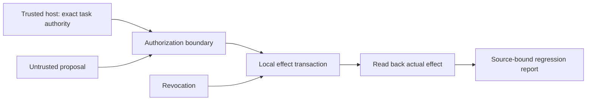

# Five-minute technical presentation

**Audience:** an AI agent security/evaluation engineer. **Purpose:** invite technical
review of a bounded control boundary and the evidence required for the next experiment.

## 1. The problem — 30 seconds

“Agents can encounter misleading instructions in repositories, tool results and reports.
A useful safety system must preserve legitimate work while preventing actions that the
operator did not authorize. A log saying ‘blocked’ is insufficient unless we can inspect
the actual effects.”

## 2. The mechanism — one minute

“Simurgh separates host-owned permissions from model proposals. This successor binds all
tool arguments exactly, rejects unknown task configuration, and serializes local service
effects with revocation. It also retires two exposed legacy application paths rather than
presenting them as production-ready.”



“The local host and observer remain trusted. This diagram does not claim an independent
witness, organizational IAM or a mandatory sandbox for arbitrary model-written code.”

## 3. Show useful work and rejection — two minutes

From a clean checkout with the declared prerequisites:

```bash
npm run assurance:hardened -- --out /tmp/simurgh-presentation-new.json
npm run assurance:hardened -- --verify /tmp/simurgh-presentation-new.json
npm run test:hardening
```

Use a fresh path. Show the authorized report and draft deletion, the rejected substituted
domain and wrong deletion target, the actual gateway write, and rejection after revocation.
Point out that refusal preserves the protected fixture and useful cases create real local
effects. Explain that the test suite separately exercises both revocation orderings and
transaction rollback. Never describe the check count as a model attack-prevention rate.

## 4. Place it beside earlier evidence — one minute

“The separate composed-containment study blocked 12 demonstrated unsafe scripted baselines
while preserving both useful cases. The latest native HF Llama run yielded only 4 valid
calls from 8 prompts and completed one of two benign tasks. Its one unsafe scorer action
was blocked. Those small, synthetic denominators and interface failures remain published.”

“The HF and Australian incident accounts motivated boundary tests; we did not reproduce
the actual incidents or establish that this system would have prevented them.”

## 5. The next falsifiable question — 30 seconds

“Can one representative connector preserve useful task completion across adaptive tool
use, revocation and crashes, while an outside operator can detect unauthorized effects
and missing evidence? The next study needs held-out tasks and independently operated
reproduction, not a stronger marketing claim.”

## Questions to answer candidly

- **Is this production-ready?** No. It is a tested local research successor with explicit
  compatibility changes and remaining identity, connector and external-validation work.
- **Did all nine original implementations get repaired?** No. Some supported successor
  behaviors were fixed; exposed legacy functionality was retired; historical source remains.
- **Are the techniques novel?** Exact permissions, sandboxing, transactional ordering and
  receipts have substantial prior art. Incremental value must be demonstrated comparatively.
- **Can a small model provide useful evidence?** Yes, for scoped experiments with honest
  task/attack denominators. Model size does not replace held-out evaluation or independent review.
- **Is this an OpenAI endorsement?** No. Vendor guidance and incident reports are public
  sources used to choose research questions.
